# RedisGUI — Modern Redis Studio & Observability Platform

<p align="center">
  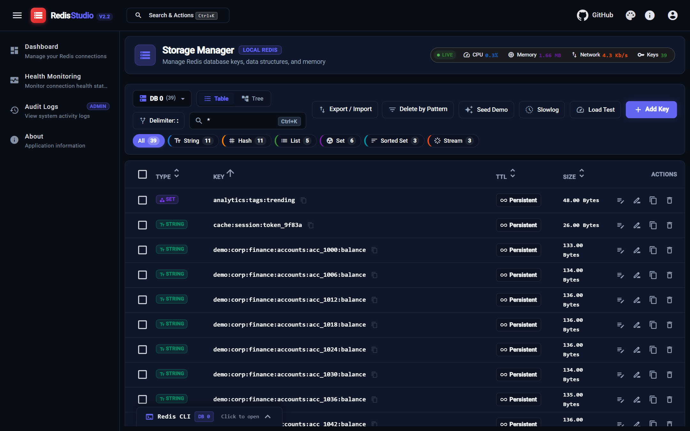
</p>

<p align="center">
  <strong>An enterprise-grade, high-performance Redis management studio and diagnostics platform built on .NET 10, ASP.NET Core Minimal APIs, and Angular 22 Signals.</strong>
</p>

<p align="center">
  
  
  
  
  
  
</p>

---

## 🌟 Key Features

### 🗄️ Comprehensive Redis Data Structure Support
Full visual inspection and editing across all native Redis types using the **Strategy Pattern**:
- **Strings**: Raw text, JSON document syntax highlighting, and exact TTL control.
- **Hashes**: Interactive field-value editor with one-click additions and deletions.
- **Lists**: Push, pop, reorder, and element navigation.
- **Sets & Sorted Sets**: Set member management and score-based ranking.
- **Streams**: Append-only log inspector with entry IDs, field-value maps, and dual Visual/JSON modes.

### ⚡ Real-Time Live Telemetry
- Sub-second live metrics streamed over **SignalR WebSockets**: Ops/sec, Memory RSS, CPU usage, and network bandwidth.
- Live status pills in the Storage Manager header with pulsing indicators.

### 📂 Dual Exploration Modes
- **Table View**: Fast virtual-scrolled data grid with instant pattern search, type filter chips, live TTL countdowns, and aligned column sorting (Key, Type, TTL, Size).
- **Namespace Tree View**: Hierarchical folder tree grouping keys by delimiter (`:`, `/`, `.`, etc.) with **direct subfolder key creation** via the folder `+` action.

### 🛠️ Interactive Redis CLI Drawer
- Built-in slide-out terminal drawer.
- Multi-database awareness (`DB 0` – `DB 15`).
- Keyboard history navigation (`↑` / `↓`).
- Output formatting for multi-bulk responses and arrays.

### 🚀 Benchmarking & Load Testing
- Run synthetic concurrent benchmarks directly from your browser.
- Configure workers, total requests, and Read/Write ratios (Read Heavy, Write Heavy, Balanced).
- Instant report of RPS, elapsed time, and `p50` / `p95` / `p99` latency percentiles.

### 🧪 Realistic Sample Data Seeder
- Populate test environments with up to 10,000 keys in seconds.
- Customize key complexity (Simple, Hierarchical, UUID), payload styles, and TTL strategies.

### 🔍 Diagnostics & Slowlog
- Real-time Slowlog viewer displaying command duration in microseconds, client IP, and query arguments.

### 🛡️ Enterprise Security & Safe Mode
- **Safe Mode (Read-Only)**: Protect production environments from accidental data mutations.
- **Audit Logging**: Full audit trail of all administrative actions and mutations.
- **JWT Authentication & RBAC**: Role-based access control (`Admin`, `Standard`, `ReadOnly`).

### 🎨 Theme Customization
- 6 vibrant color schemes (Deep Violet, Emerald Green, Indigo Night, Crimson Gold, Cyan Amber, Charcoal).
- One-click Dark and Light theme toggles.

---

## 📸 Screenshots Gallery

| Dashboard & Metrics | Storage Manager (Table View) |
| :---: | :---: |
| 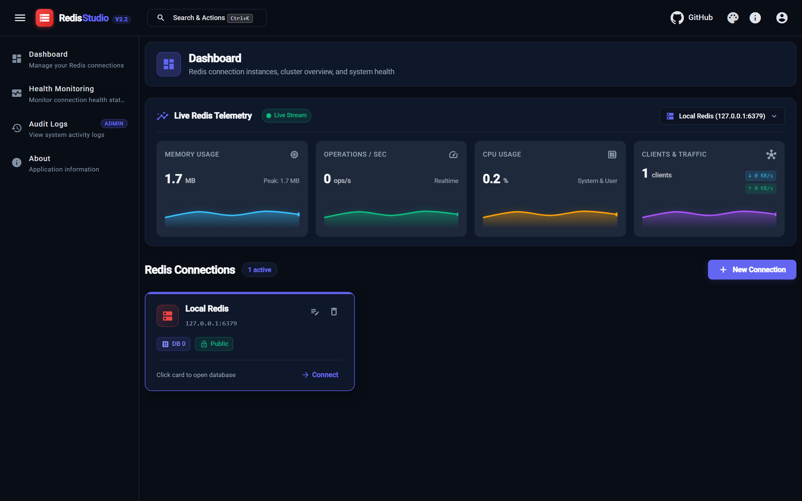 |  |

| Namespace Tree View | Hash Key Visual Editor |
| :---: | :---: |
| 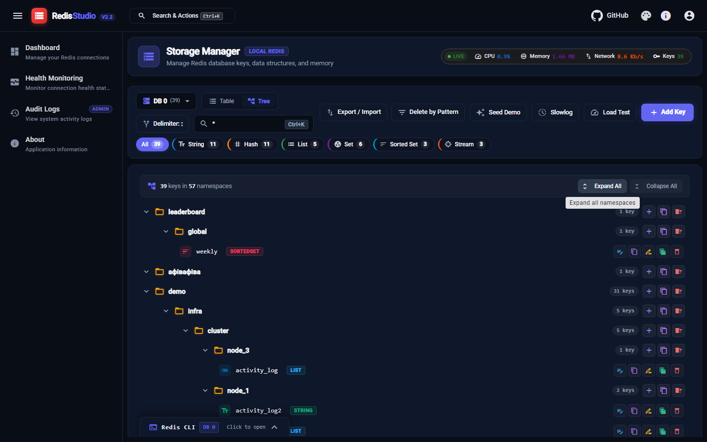 | 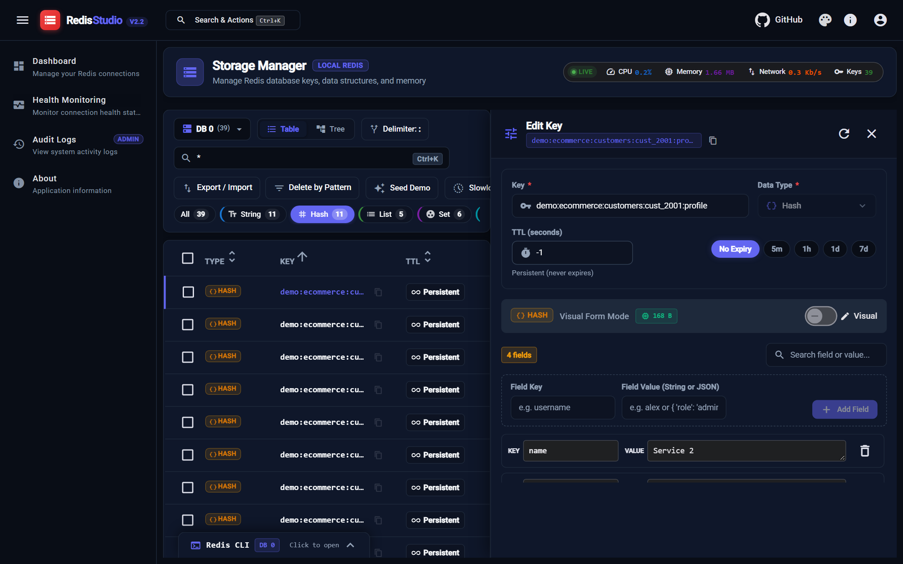 |

| Stream Visual Editor | Stream JSON Document View |
| :---: | :---: |
| 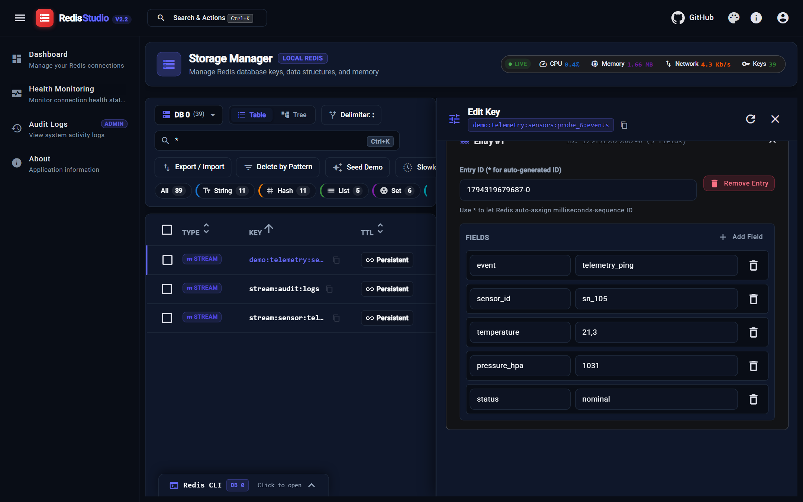 | 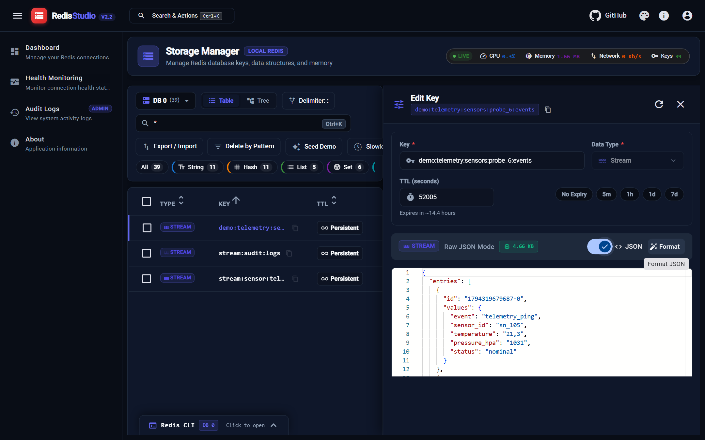 |

| String / JSON Value Editor | Add New Key Modal |
| :---: | :---: |
| 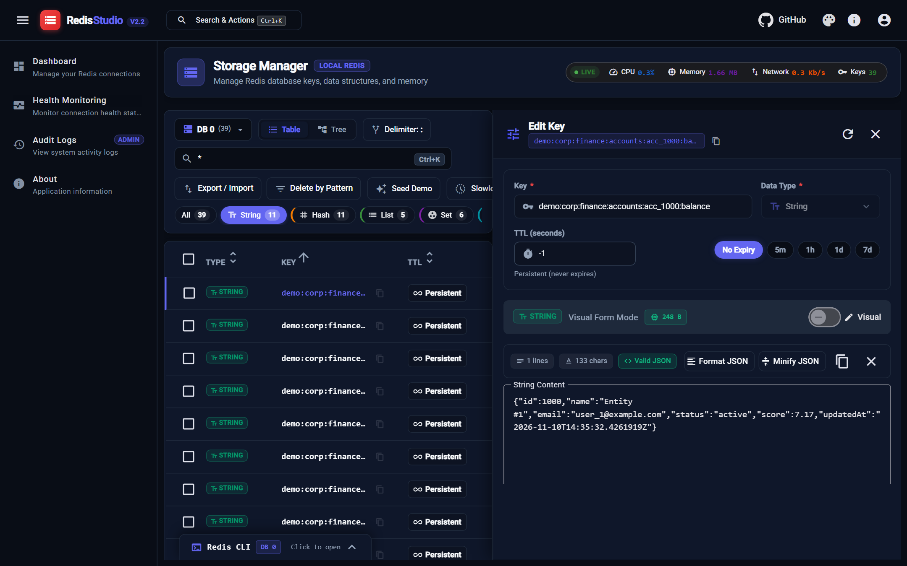 | 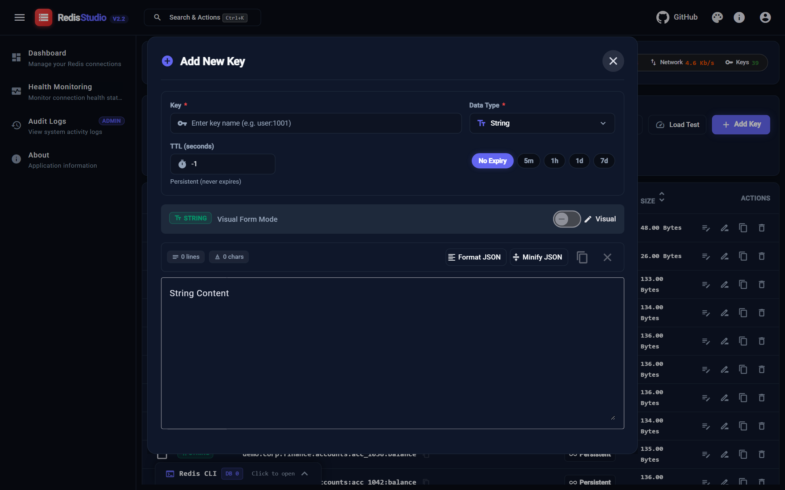 |

| Synthetic Load Testing | Interactive CLI Terminal |
| :---: | :---: |
| 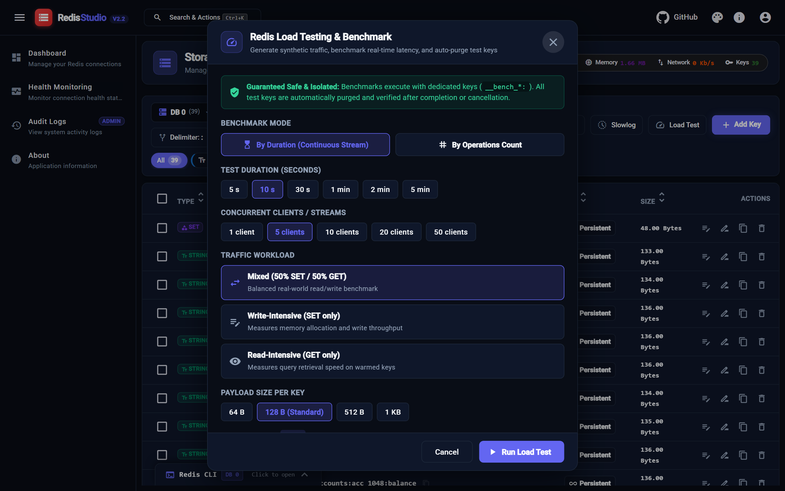 | 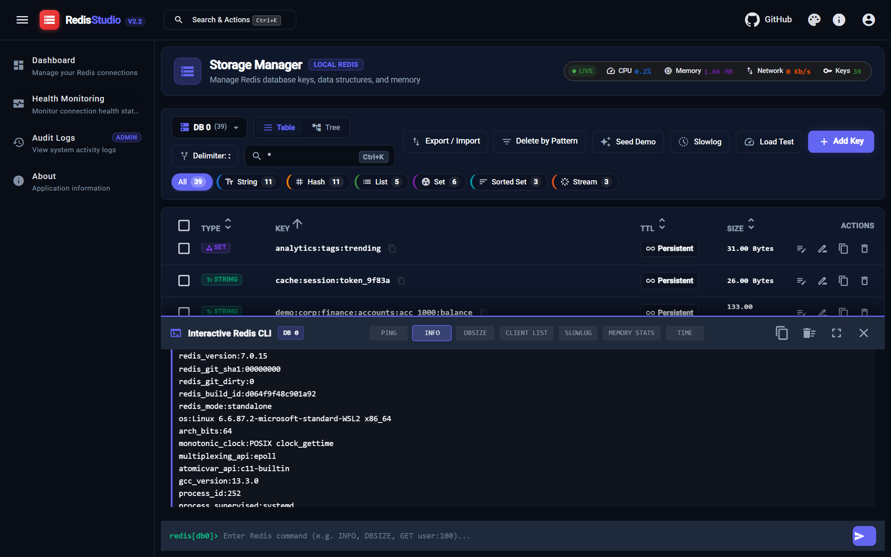 |

| Sample Data Seeder | Slowlog Diagnostics |
| :---: | :---: |
| 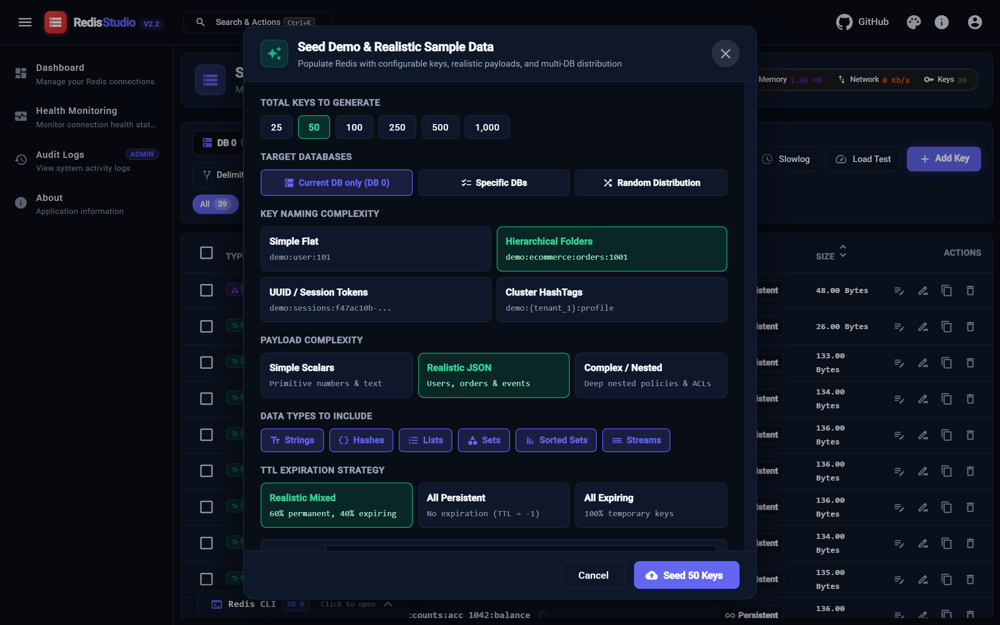 | 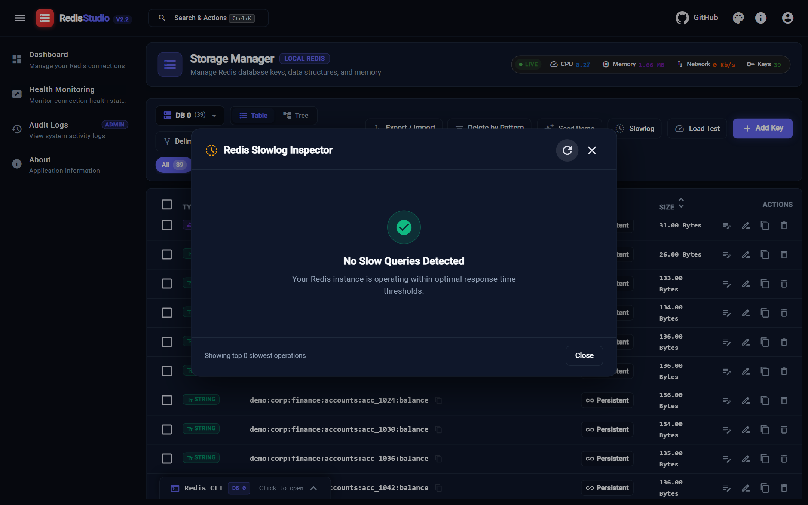 |

| Command Palette (Ctrl+K) | Add Connection Dialog |
| :---: | :---: |
| 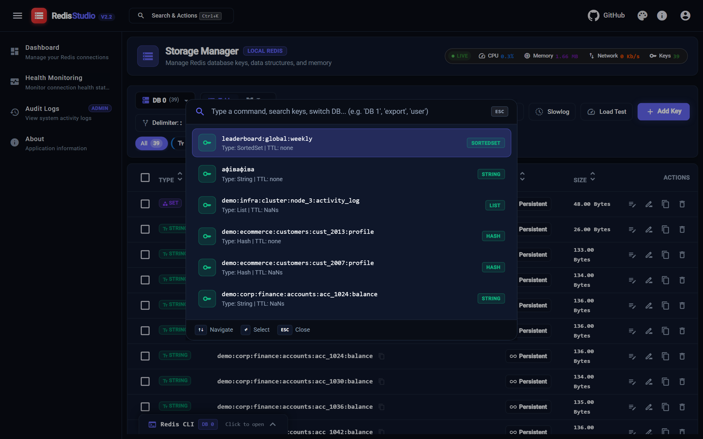 | 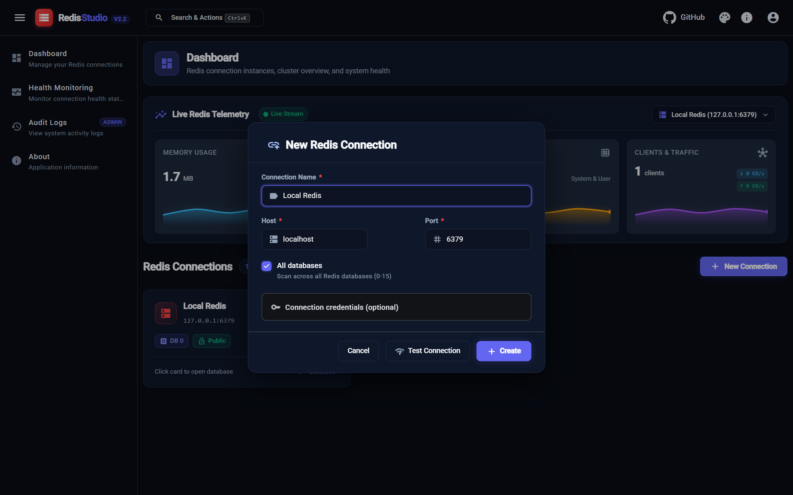 |

| Audit Logs & Compliance | Light Theme Preview |
| :---: | :---: |
| 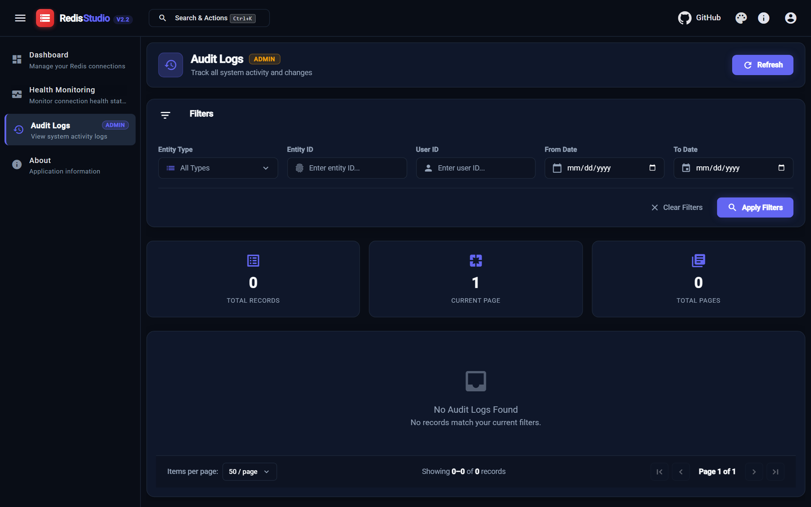 | 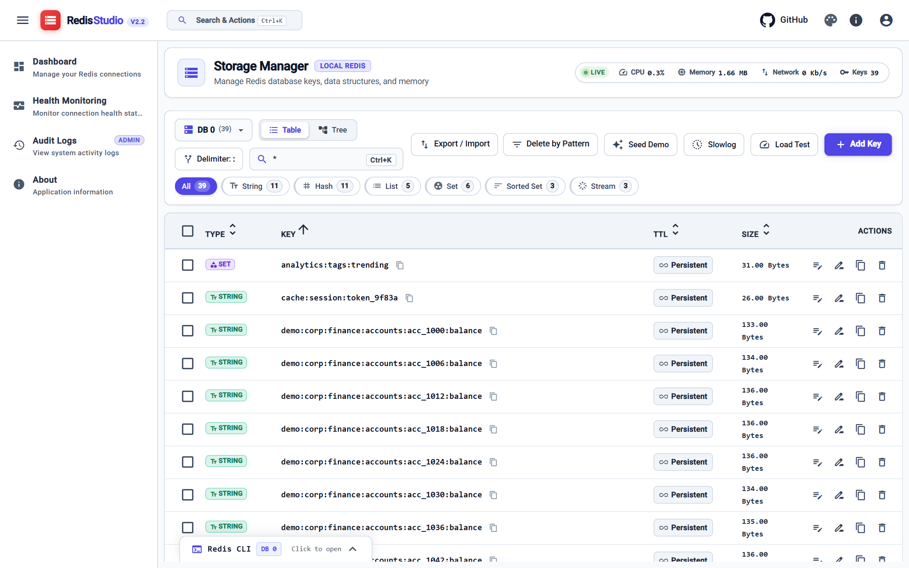 |

---

## 🏗️ Architecture & Tech Stack

RedisGUI follows **Clean Architecture** and **CQRS**:

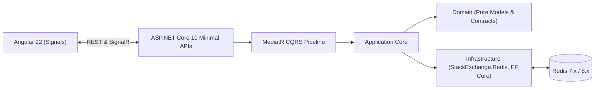

- **Backend**: .NET 10, ASP.NET Core Minimal APIs, MediatR, FluentValidation, StackExchange.Redis, Entity Framework Core.
- **Frontend**: Angular 22 (Standalone Components, Signals, Signal Forms), Angular Material 22, Tailwind CSS, Monaco Editor.
- **Architecture Highlights**:
  - **No magic values**: Strongly-typed enums (`RedisDataType`, `UserRole`) synced between client and server.
  - **Strategy & Factory Patterns**: Handlers registered in DI container and resolved dynamically without manual `new` instantiation.
  - **Invariant Culture Parsers**: Resilient reflection metrics collectors supporting any OS locale.

---

## 🚀 Quickstart

### Option 1: Run with Docker Compose (Recommended)

Clone the repository and run:

```bash
docker compose up -d --build
```

Navigate to:
- **Web Studio**: [http://localhost:5000](http://localhost:5000)
- **Redis Server**: `localhost:6379`

#### Default Credentials:
- **Email**: `admin@redisgui.local`
- **Password**: `AdminPassword123!`

---

### Option 2: Local Development

#### Prerequisites
- [.NET 10 SDK](https://dotnet.microsoft.com/)
- [Node.js & npm](https://nodejs.org/) (Node 22.22.3+, 24.15+, or 26.x)
- Running Redis instance on `127.0.0.1:6379` (e.g. via Docker or WSL)

#### Start Angular and ASP.NET Core together

Run these commands from the repository root.

```bash
npm ci --prefix src/RedisGUI.Client
dotnet run --project src/RedisGUI.Server --launch-profile https
```

Open [the backend root](https://localhost:61034/) to activate the ASP.NET Core SPA proxy. It starts the Angular dev server and redirects to [the client](https://localhost:4200/). Angular forwards API and SignalR requests to the backend.

In Visual Studio, open `RedisGUI.slnx`, select the shared **RedisGUI (Angular + API)** launch profile, and press **F5**. The profile starts both projects and opens Angular in the browser. If your browser prompts about the local development certificate, use `dotnet dev-certs https --trust`.

---

## 🧪 Running Tests

The test suite covers domain logic, CQRS handlers, type handlers, and infrastructure:

```bash
dotnet test RedisGUI.slnx
```
*(350+ automated unit & integration tests)*

---

## 📚 Documentation & Technical References

- 🏛️ [System Architecture & Design Details](docs/architecture.md) — Clean Architecture layers, CQRS, Strategy/Factory patterns, Connection Pooling.
- 📦 [Projects & Solution Structure](docs/projects-structure.md) — Comprehensive breakdown of every project in `RedisGUI.slnx`, classes, and tests.
- ⚙️ [Configuration & Settings Guide](docs/configuration.md) — Full reference for `appsettings.json`, JWT, Redis timeouts, Docker env vars.
- 📊 [Architectural Diagrams & Flowcharts](docs/diagrams.md) — Complete Mermaid diagrams (Architecture, ER, CQRS pipeline, SignalR, CLI, Load testing).
- 📋 [Comprehensive Feature Catalog](docs/features.md) — Specifications for all 10+ core feature modules and API contracts.
- 📖 [User Guide & Operations Manual](docs/user-guide.md) — Step-by-step user manual with screenshots for every feature.
- 🐳 [Docker Deployment & Configuration](docs/docker.md) — Production multi-stage Docker builds and docker-compose orchestration.

---

## 📄 License

This project is licensed under the MIT License.
