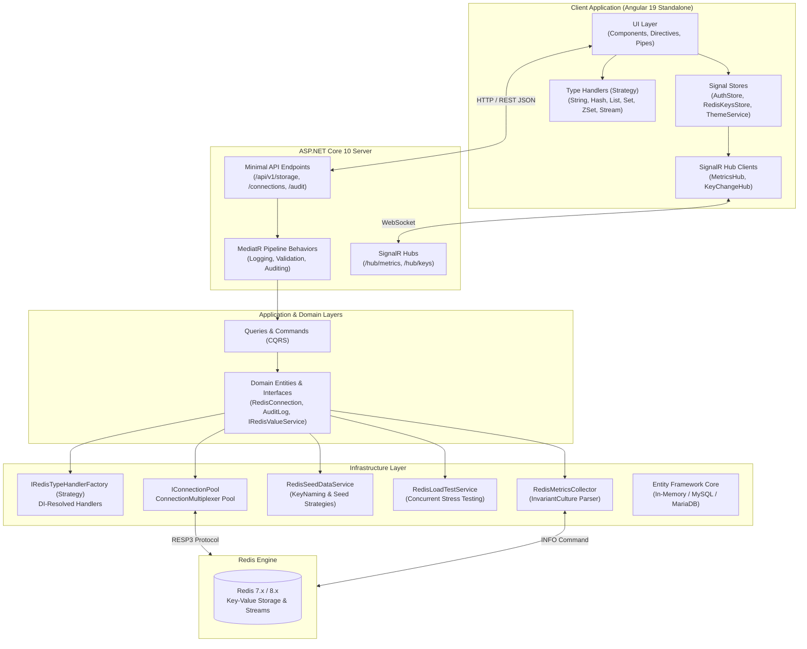
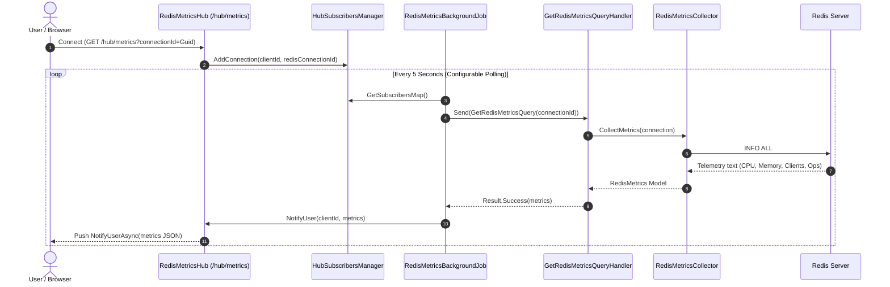
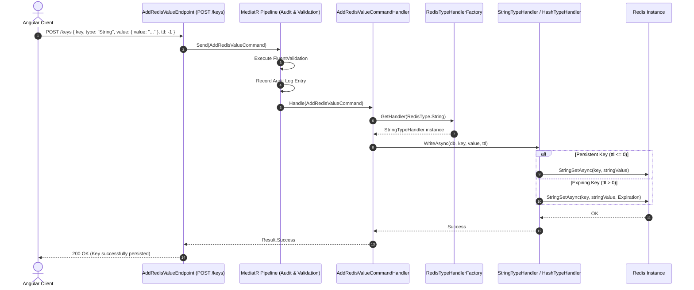

# RedisGUI — System Architecture & Design Documentation

## 1. Overview & Architectural Principles

**RedisGUI** is an enterprise-grade, high-performance Redis management studio and diagnostics platform built on modern **.NET 10** and **Angular 19**.

The solution strictly adheres to the following engineering paradigms:
- **Clean Architecture & Onion Architecture**: Absolute separation of concerns where business rules (Domain) have zero dependencies on external frameworks or databases.
- **CQRS (Command Query Responsibility Segregation)**: Read operations and write operations are modeled as distinct queries and commands via MediatR.
- **Strict Strong Typing & Enum Consistency**: Zero magic strings or loose integer constants. Data structures, Redis types, and role models are mapped to strongly-typed enums synchronized between backend and frontend contracts.
- **Pure Dependency Injection (Inversion of Control)**: All strategies, factories, and type handlers are registered in the DI container and injected automatically without manual `new` instantiation.
- **Reactive State & Streaming**: Angular Signals for reactive UI state management and WebSockets via ASP.NET Core SignalR for real-time live metrics and key space monitoring.

---

## 2. High-Level Solution Topology



---

## 3. Clean Architecture Project Structure

The project is structured into clean layers according to Robert C. Martin's Clean Architecture:

| Project | Role & Responsibilities | Dependencies |
| :--- | :--- | :--- |
| **`RedisGUI.Domain`** | Enterprise domain models (`RedisConnection`, `User`, `AuditLog`), enums (`RedisDataType`, `UserRole`), abstractions and domain exceptions. | None (pure .NET standard) |
| **`RedisGUI.Shared`** | Cross-cutting primitives: `Result<T>`, `Error`, custom MediatR pipeline contracts (`ICommand`, `IQuery`, `ICommandHandler`), JSON options. | None |
| **`RedisGUI.Application`** | CQRS command & query handlers, FluentValidation rules, pipeline behaviors (`AuditingBehavior`, `ValidationBehavior`, `LoggingBehavior`). | `RedisGUI.Domain`, `RedisGUI.Shared` |
| **`RedisGUI.Infrastructure`** | StackExchange.Redis integration, `IConnectionPool`, type handler strategies, diagnostics, background telemetry jobs, EF Core persistence. | `RedisGUI.Application`, StackExchange.Redis, EF Core |
| **`RedisGUI.Server`** | ASP.NET Core 10 Host, RESTful Minimal APIs, SignalR Hubs (`RedisMetricsHub`), JWT middleware, rate limiting, OpenAPI/Swagger. | `RedisGUI.Infrastructure` |
| **`RedisGUI.Client`** | Modern Angular 19 application with signals, Angular Material 19, Tailwind CSS, Monaco editor, SignalR client. | Pure TypeScript / Web platform |

---

## 4. Key Design Patterns & Implementations

### 4.1. Strategy Pattern for Redis Data Types
Each Redis data structure (`String`, `Hash`, `List`, `Set`, `SortedSet`, `Stream`) has unique reading, writing, serialization, and memory representation requirements.
- **Interface**: `IRedisTypeHandler` defines `Type`, `ReadAsync(IDatabase db, string key)`, and `WriteAsync(IDatabase db, string key, object value, TimeSpan? ttl)`.
- **Implementations**:
  - `StringTypeHandler`: Handles raw strings, formatted JSON strings, and manages strict TTL (using `StringSetAsync` with or without `Expiration` struct to avoid `SETEX 0` errors).
  - `HashTypeHandler`: Handles field-value maps, batch writes (`HashSetAsync`), and nested JSON values.
  - `ListTypeHandler`: Ordered collection handlers (`ListRangeAsync`, `ListRightPushAsync`).
  - `SetTypeHandler`: Distinct string sets (`SetMembersAsync`, `SetAddAsync`).
  - `SortedSetTypeHandler`: Member-score collections (`SortedSetRangeByRankWithScoresAsync`).
  - `StreamTypeHandler`: Append-only event streams (`StreamReadAsync`, `StreamAddAsync`).
- **DI Registration & Factory**: Handlers are registered as `IRedisTypeHandler` singletons in `src/RedisGUI.Infrastructure/DependencyInjection.cs` and injected into `RedisTypeHandlerFactory`:
```csharp
public sealed class RedisTypeHandlerFactory : IRedisTypeHandlerFactory
{
    private readonly Dictionary<RedisType, IRedisTypeHandler> _handlers;

    public RedisTypeHandlerFactory(IEnumerable<IRedisTypeHandler> handlers)
    {
        _handlers = handlers.ToDictionary(h => h.Type);
    }

    public IRedisTypeHandler? GetHandler(RedisType type) => _handlers.GetValueOrDefault(type);
}
```

### 4.2. Angular Type Handlers (Client Strategy Pattern)
The frontend mirrors the backend strategy pattern:
- Handlers (`StringTypeHandler`, `HashTypeHandler`, `ListTypeHandler`, `SetTypeHandler`, `SortedSetTypeHandler`, `StreamTypeHandler`) are decorated with `@Injectable({ providedIn: 'root' })`.
- `RedisTypeHandlerRegistry` injects all handlers via Angular DI, providing validation, visual-to-JSON transformations, and JSON schema formatting without runtime string heuristics.

### 4.3. Resilient Connection Pooling (`IConnectionPool`)
- Manages cached, thread-safe instances of StackExchange.Redis `IConnectionMultiplexer`.
- Performs lazy connection creation, connection multiplexing over single sockets, and automatic network reconnects with exponential backoff.
- Features multi-environment fallback: gracefully falls back from Docker container hostnames (`redis:6379`) to host loopback (`127.0.0.1:6379`) when running in local development mode.

### 4.4. Culture-Invariant Telemetry & Diagnostics
Redis returns server info fields (e.g. `used_cpu_sys:0.01`, `instantaneous_input_kbps:0.00`) formatted with the dot (`.`) decimal separator regardless of host OS language.
The telemetry engine uses `CultureInfo.InvariantCulture` and `NumberStyles.Any` across all reflection parsers (`RedisMetricsExtensions.cs`), preventing localization formatting errors in European and Ukrainian Windows environments.

---

## 5. Sequence Diagrams

### 5.1. Real-Time Telemetry Pipeline


### 5.2. Key Creation & Value Deserialization Flow


---

## 6. Security & Audit Architecture

1. **JWT Bearer Authentication**: Short-lived access tokens with cryptographic signatures and automatic silent refresh cycles.
2. **Role-Based Access Control (RBAC)**:
   - `Admin`: Full permissions (Connection configuration, Slowlog, Load testing, Data seeding, CLI).
   - `Standard`: Read/Write access to keys and metrics.
   - `ReadOnly`: Enforced safe mode; write, delete, and mutation commands are rejected at the MediatR command pipeline level.
3. **Safe Mode Enforcement**:
   - Connections can be toggled to "Read-Only" mode. Any `ICommand` executing write or delete commands against a read-only connection is intercepted and aborted before reaching Redis.
4. **Audit Logging Pipeline**:
   - All mutations, CLI commands, bulk operations, and seed runs are automatically logged to the audit repository with timestamp, user ID, IP address, connection ID, and operation status.
