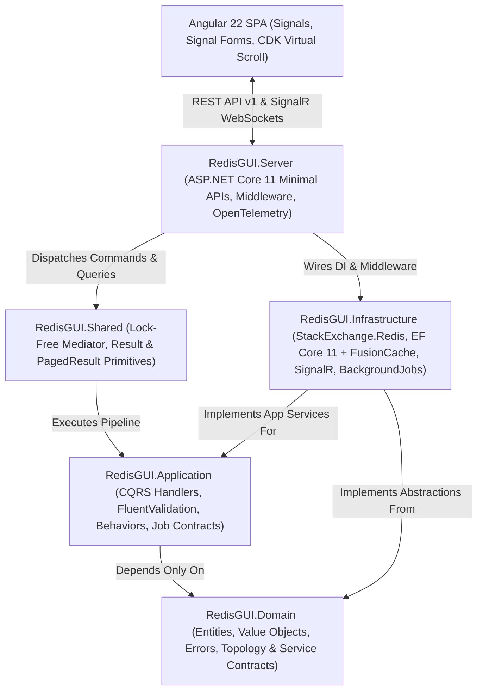

# RedisGUI — System Architecture & Engineering Design

RedisGUI follows **Clean Architecture**, **Domain-Driven Design (DDD)**, and **CQRS**, powered by **.NET 11 / ASP.NET Core 11 Minimal APIs** on the backend and **Angular 22 Signals** on the frontend. Concurrency-sensitive hot paths are engineered with lock-free coordination primitives, while long-running Redis operations execute through a typed, extensible background job platform streamed over **SignalR**.

---

## 1. Layered Architectural Overview

The dependency rule flows strictly inward toward the **Domain** core:

### Layer Responsibilities
- **`RedisGUI.Domain`**: Zero external package dependencies. Defines aggregate roots (`RedisConnection`, `User`, `AuditLog`), strongly-typed value objects, railway error definitions (`DomainErrors`), `IRedisTopologyRegistry` (`RedisServerMode`), binary-safe `RedisKeyMetadata` / `RedisKeyScanPage`, and domain service contracts.
- **`RedisGUI.Shared`**: Provides `Result` / `Result<T>` railway-oriented monads, `PagedResult<T>`, `ValueObject`, and the in-process **Mediator** (`Mediator`, `PipelineRegistry`, `NotificationRegistry`).
- **`RedisGUI.Application`**: Vertical feature slices (`Connections`, `Redis`, `RedisMetrics`, `Audit`, `Users`) containing commands, queries, `FluentValidation` validators, pipeline behaviors (`ValidationBehavior`, `LoggingBehavior`, `AuditingBehavior`), ownership checks (`IConnectionAccessService`), and typed background job handlers (`IBackgroundJobHandler`).
- **`RedisGUI.Infrastructure`**: Implements `IRedisConnectionManager` connection pooling, Strategy/Factory data type handlers, standalone & Redis Cluster `SCAN`, MySQL/InMemory persistence with L2 query caching, background job worker pool, and four SignalR hubs.
- **`RedisGUI.Server`**: Hosts Minimal API endpoints under `api/v1`, RFC 9457 Problem Details error mapping, correlation IDs, rate limiting (`auth`, `sensitive`), Swagger/OpenAPI, OpenTelemetry exporters, and compiled Angular SPA static delivery.

---

## 2. Lock-Free Concurrency & High-Throughput Patterns

Hot-path coordination components avoid coarse `lock` contention in favor of atomic CAS transitions, immutable snapshots, and bounded channels:

- **Lock-Free Mediator Pipelines (`PipelineRegistry`)**: Pipeline behaviors are appended using atomic compare-and-swap array replacement (`[.. current, item]`) paired with `ConcurrentDictionary` generic dispatch caches so request execution reads lock-free snapshots without blocking writers.
- **Lock-Free Redis Connection Pool (`RedisConnectionManager`)**:
  - Pooled `ConnectionMultiplexer` entries (`ConnectionEntry`) use `Volatile` reads, `Interlocked.CompareExchange` state transitions, and lock-free active-operation reference counters (`LockFreeCounter`).
  - `RedisConfigurationSanitizer.ComputeFingerprint` detects config changes and triggers graceful retirement with a configurable `DrainTimeout` so in-flight commands complete before old multiplexers dispose.
  - Background idle eviction (`EvictionInterval`, `IdleTimeout`) and capacity enforcement keep memory bounded (`MaxConnections`).
- **Lock-Free Key-Change Subscriptions (`KeyChangeSubscriptionManager`)**: Manages `/hub/keychange` SignalR subscriber sets without global locks across concurrent watch/unwatch churn.
- **Lock-Free Background Job Registry (`BackgroundJobSubscriptionRegistry`)**: Tracks SignalR `/hub/jobs` client subscriptions per job ID for real-time MPSC progress fan-out and instant access revocation.

---

## 3. Extensible Background Jobs & Live Notification Center

All long-running and multi-key operations (`bulk-keys`, `load-test`, `seed-data`, `redis-export`, `redis-import`) run independently of HTTP request timeouts inside **`BackgroundJobManager`**:

- **Handler Plugin Model (`IBackgroundJobHandler`)**: Handlers declare `BackgroundJobKindMetadata` (`Kind`, `DisplayName`, `RequiresWriteAccess`, `MaxParameterCharacters`) discovered dynamically via `GET /api/v1/jobs/kinds`. New job types can be added purely in DI without switching/modifying core queue code.
- **Bounded Channel Scheduler**: Multiple worker tasks drain a bounded `Channel<QueuedJob>` (`WorkerCount`, `QueueCapacity`) while enforcing per-owner quotas, `MaxActiveParameterBytes`, and failure-vs-cancellation isolation.
- **Download Leases & Result Retention**: Completed export downloads acquire short-lived leases so the background retention pruner never deletes an artifact mid-download.
- **SignalR Live Streaming (`/hub/jobs` — `BackgroundJobsHub`)**:
  - Clients connect using `BackgroundJobsService` with automatic initial connection retry and reconnect recovery.
  - Enforces per-connection authorization on `Subscribe` and pushes immediate **`AccessRevoked`** notifications whenever a connection's ownership or user authorization is revoked.
- **Global Frontend State (`BackgroundJobsStore` + `JobNotificationCenterComponent`)**: Unifies progress/result state across the top-bar Notification Center and feature dialogs (`SeedDataDialog`, `LoadTestDialog`, `ExportDialog`, `ImportDialog`, `BulkJobProgress`).

---

## 4. Redis Cluster Topology, Cursor Safety & Binary Keys

- **Runtime Topology Detection (`IRedisTopologyRegistry`)**: Records detected `RedisServerMode` (`Standalone`, `Cluster`, `Sentinel`) per connection across health monitors, key scans, CLI, and server diagnostics (`INFO AllSections` + `CLUSTER NODES`), propagating the mode to `GetConnectionResponse`, `GetConnectionHealthResponse`, and `RedisKeyScanPage`.
- **Multi-Primary Cluster `SCAN` (`RedisKeyScan`)**:
  - Iterates across all Cluster primary nodes while preserving DB 0 semantics (automatically locking non-0 databases out in Cluster mode across `SCAN`, `Seed`, `LoadTest`, `Export/Import`, and `MessagingHub.WatchStream`).
  - Encodes continuation cursors in HMAC-signed tokens binding cluster shard endpoints & slot topology so any mid-scan `CLUSTER FAILOVER` rejects stale continuation (`Redis.InvalidCursor` / `Redis.ScanUnavailable`) rather than silently dropping or duplicating keys.
- **Binary-Safe Key Identity (`KeyBase64`, `IsBinary`)**:
  - Binary keys containing invalid UTF-8 sequences or control bytes carry base64-encoded raw byte identities (`KeyBase64`, `IsBinary = true`) across `RedisKeyMetadata`, visual editors (`Get/Update/Delete/Rename/Duplicate`), snapshot JSON export/import, and query-parameterized routes (`api/v1/storage/{connectionId:guid}/key?keyBase64=...`).

---

## 5. Authorization, RFC 9457 Problem Details & EF Core Query Caching

- **Connection Ownership Security (`IConnectionAccessService`)**: Enforces `ConnectionOwnershipRequirement` across REST endpoints, CQRS handlers (`Connections/*`, `Keys/*`, `Diagnostics/*`, `DataTransfer/*`, `Messaging`), background jobs, and authenticated SignalR hubs (`/hub/jobs`, `/hub/messaging`).
- **Global Error Mapping (`ErrorResultExtensions` & `GlobalExceptionHandlerMiddleware`)**: Translates structured domain `Error` codes and `ErrorException` instances uniformly into RFC 9457 `ProblemDetails` status codes: `404` (`*.NotFound`), `403` (`*.Forbidden`, `Connection.ReadOnlyMode`, `User.Deactivated`), `401` (`User.InvalidCredentials`), `408` (`*.Cancelled`), `409` (`*.Conflict`, `Storage.KeyAlreadyExists`), `502` (`Redis.ScanFailed`, `Export/Import/Config`), `503` (`Redis.ScanUnavailable`, `Connection.NotEstablished`), `400` (validation/bad input), and `500` (internal faults).
- **Parameter-Aware SQL Caching (`CachingInterceptor` + `CacheKeyProvider` + FusionCache)**: Transparently caches EF Core read queries for configured tables (`AnonymousRedisConnection`, `RedisConnectionWithCredentials`) using SHA-256 fingerprints built over both trimmed SQL command text **and** culture-invariant typed `DbParameter` values, automatically invalidating by table tag on CRUD writes.

---

## 6. Frontend Architecture (Angular 22 Signals + CDK Virtual Scroll)

- **Modern Angular 22 Primitives**: 100% standalone components with `ChangeDetectionStrategy.OnPush`, signal `input()`/`output()`, **Signal Forms**, and `@ngrx/signals` `signalStore` state containers (`AuthStore`, `ConnectionsStore`, `RedisKeysStore`, `BackgroundJobsStore`, `SideNavStore`, `ServerInfoStore`).
- **High-Density Virtualized Storage Manager**: Renders large scanned keysets inside `<cdk-virtual-scroll-viewport>` (`*cdkVirtualFor`) with threshold-based automatic `Load more` cursor pagination, binary `BIN` badges, Cluster DB 0 locking, and namespace delimiter trees.
- **Per-User Reload Restoration & Clean Sign-Out**: `SideNavStore` restores active connection navigation cleanly across browser reloads while resetting all user-scoped stores (`ConnectionsStore`, `BackgroundJobsStore`, `RedisKeysStore`, `SideNavStore`) on logout.

---

## 7. Real-Time Telemetry & OpenTelemetry Observability

- **Zero-Allocation Metric Reflection**: `RedisMetrics` uses `[RedisMetric]` attributes paired with `RedisInfoParser` and invariant culture number parsing (`float`, `long`) across OS locales.
- **4 Dedicated SignalR Hubs**: `/hub/metrics` (`RedisMetricsBackgroundJob`), `/hub/keychange` (`KeyChangeHub`), `/hub/messaging` (`MessagingHub` Pub/Sub & Stream inspector), and `/hub/jobs` (`BackgroundJobsHub`).
- **OpenTelemetry (`RedisGUI.*`)**: Collects ASP.NET Core, EF Core, HttpClient, runtime/process telemetry plus custom `RedisGUI.BackgroundJobs` job counters and durations.
