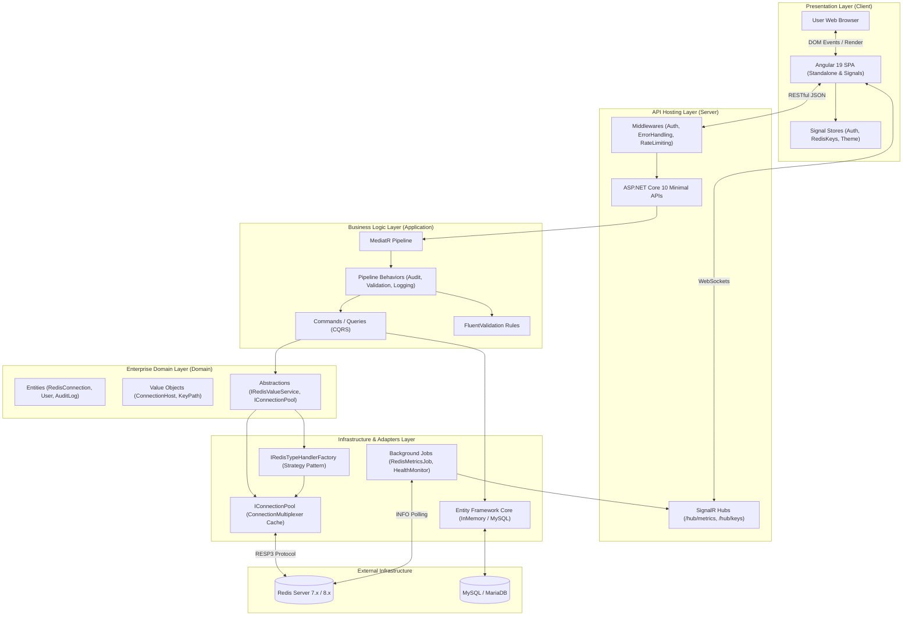
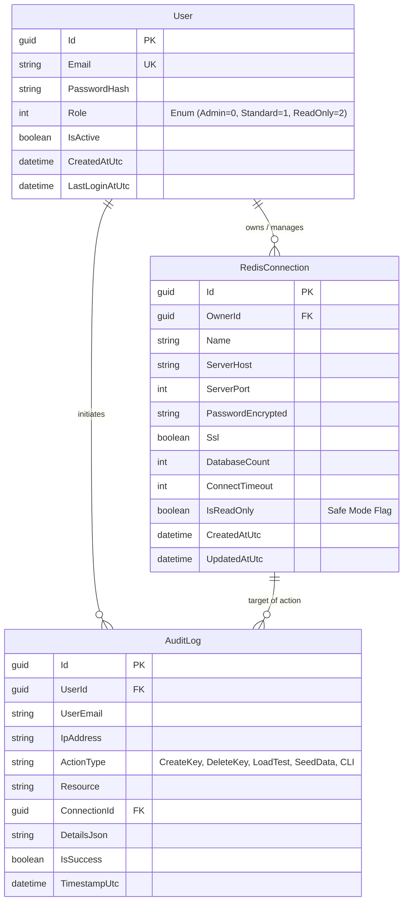
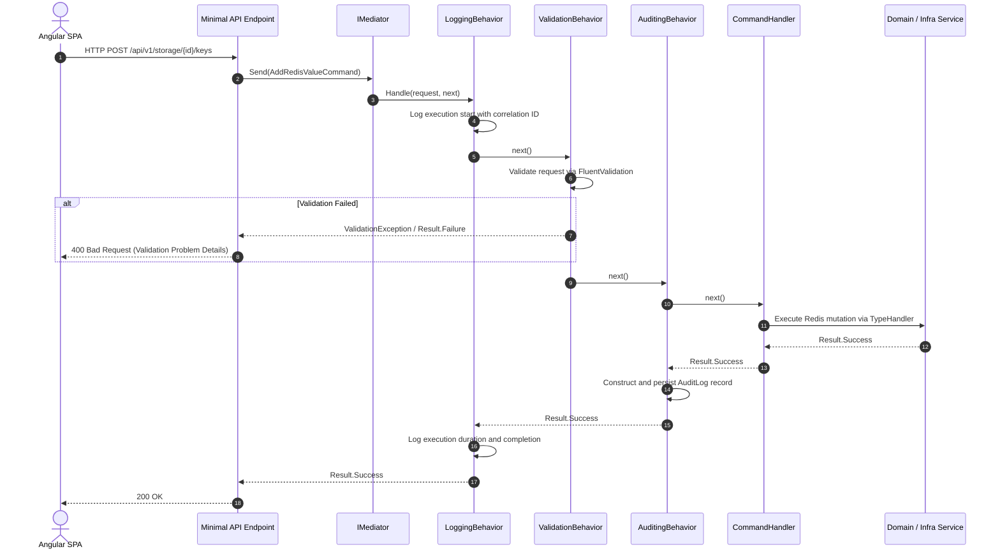
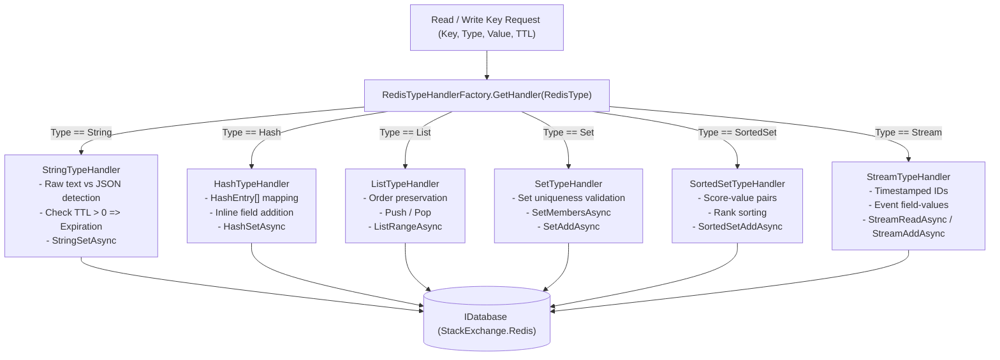
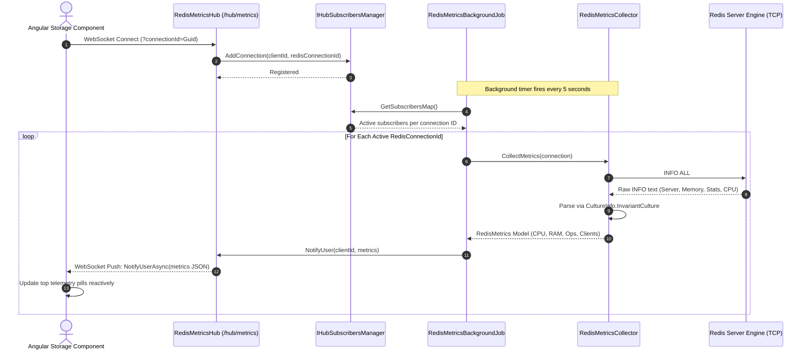
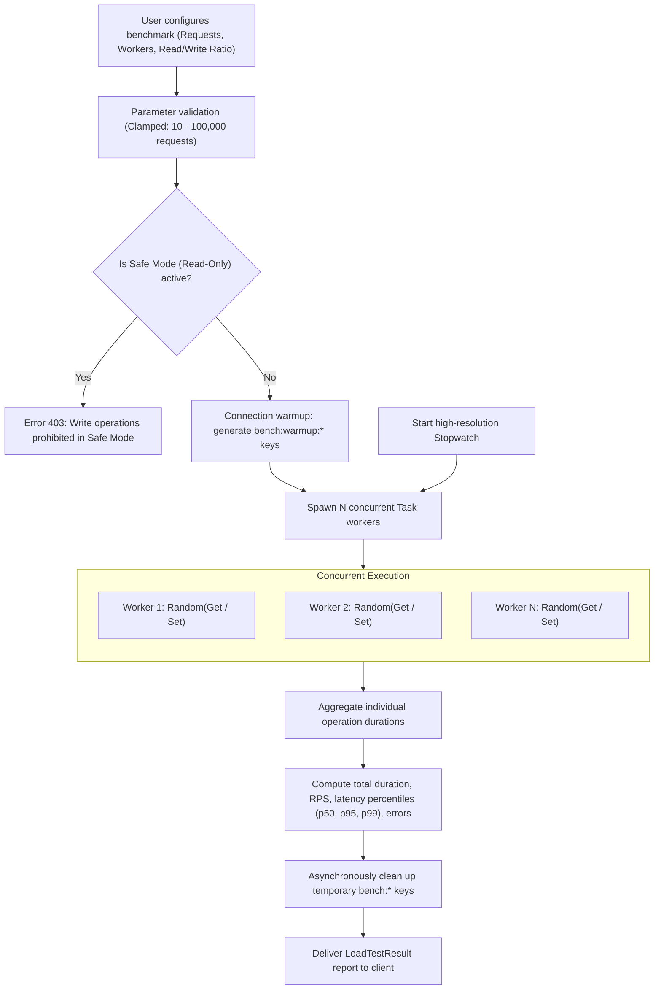
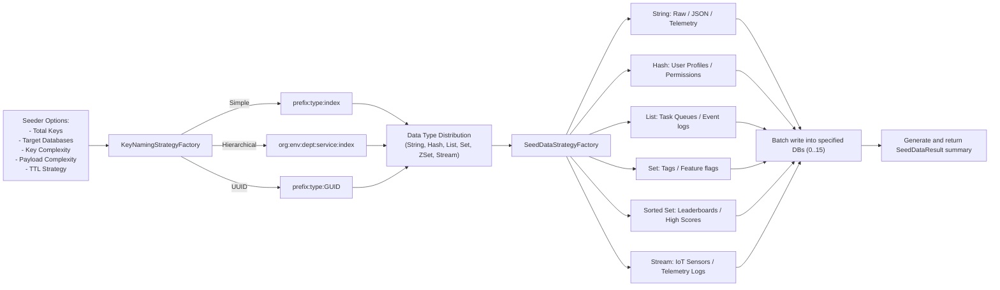
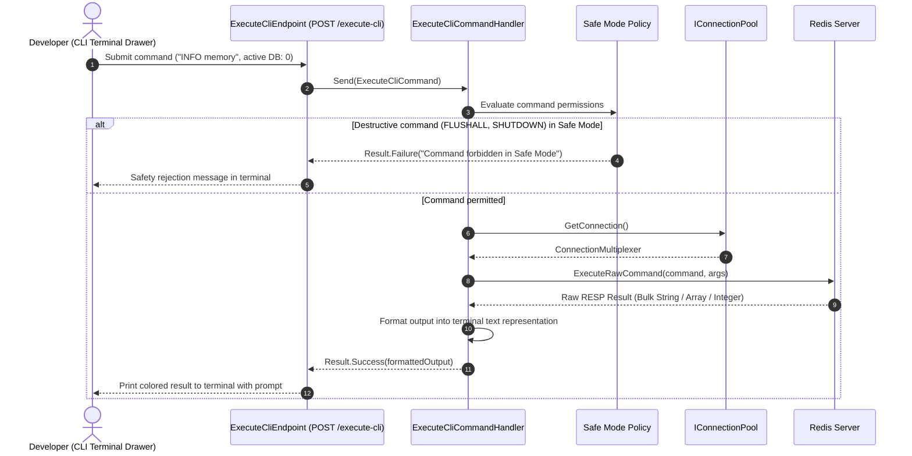

# RedisGUI — Architectural Diagrams, Sequences & Flowcharts

This document provides a comprehensive collection of Mermaid diagrams detailing the architectural design, entity relationships, CQRS execution pipelines, and workflows within **RedisGUI**.

---

## 1. Overall System Architecture (Clean Architecture Flowchart)

---

## 2. Entity-Relationship Diagram (ERD)

---

## 3. Sequence Diagram: CQRS MediatR Pipeline Execution

---

## 4. Strategy Pattern for Redis Data Types

---

## 5. Sequence Diagram: Real-Time Telemetry Streaming (SignalR)

---

## 6. Flowchart: Synthetic Benchmark & Load Testing Workflow

---

## 7. Flowchart: Realistic Sample Data Seeder Pipeline

---

## 8. Sequence Diagram: Interactive Redis CLI Command Execution

