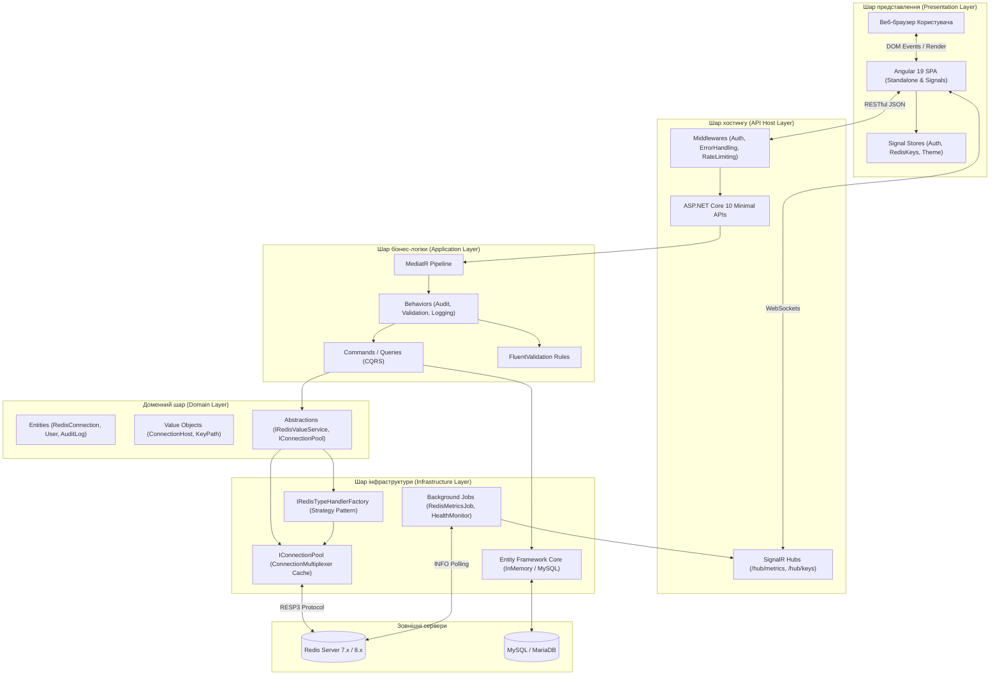
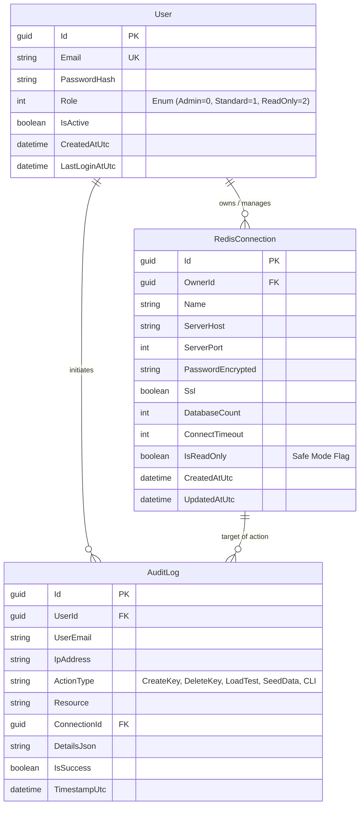
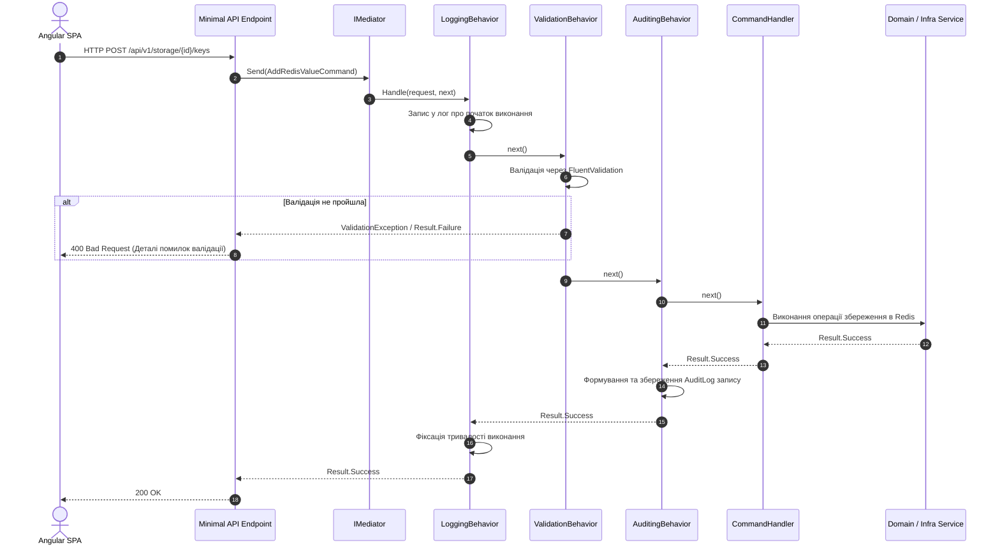
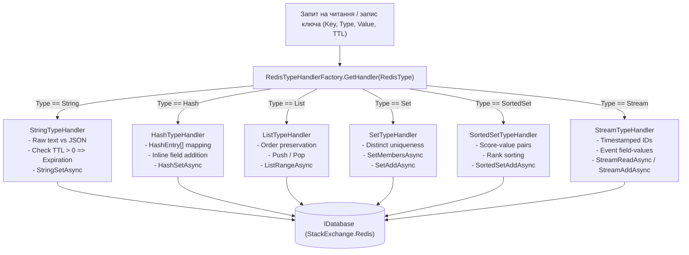
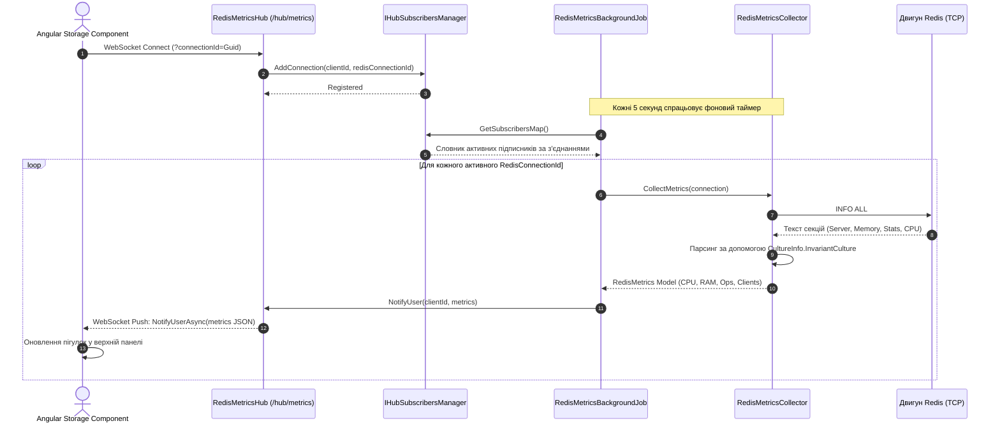
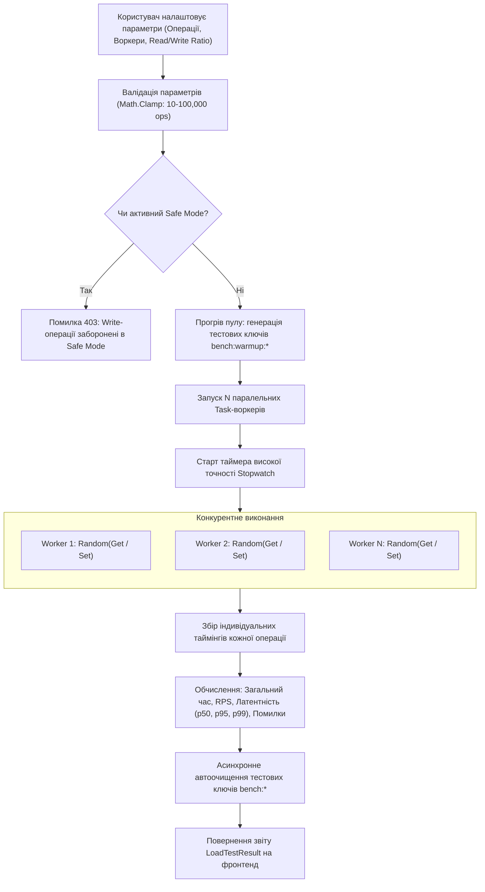
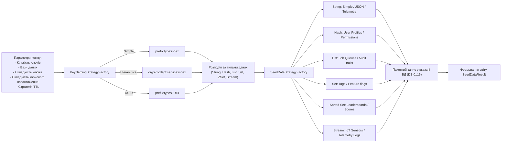
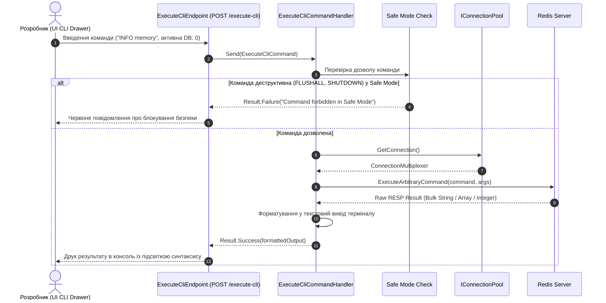

# RedisGUI — Архітектурні діаграми, послідовності та флоучарти

У цьому розділі наведено вичерпну колекцію діаграм Mermaid, що описують архітектурні рішення, структури даних та динаміку ключових процесів платформи **RedisGUI**.

---

## 1. Загальна архітектура системи (Clean Architecture Flowchart)

---

## 2. Модель сутностей даних (Entity-Relationship Diagram)

---

## 3. Діаграма послідовності: CQRS MediatR Pipeline

---

## 4. Паттерн Стратегія (Strategy Pattern) для типів даних Redis

---

## 5. Діаграма послідовності: Жива трансляція телеметрії (SignalR Telemetry)

---

## 6. Флоучарт синтетичного навантажувального тестування (Load Testing Workflow)

---

## 7. Флоучарт генератора демо-даних (Smart Data Seeder Pipeline)

---

## 8. Діаграма послідовності: Виконання команд у Redis CLI Terminal

