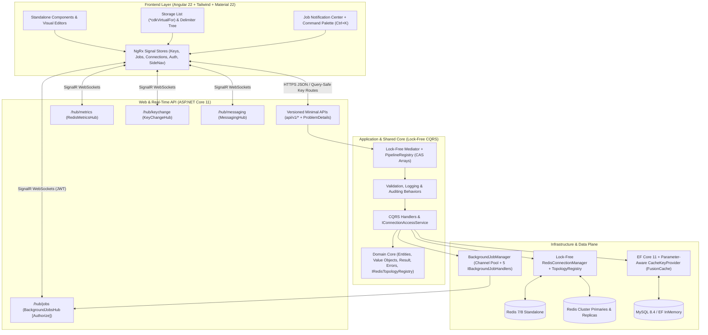
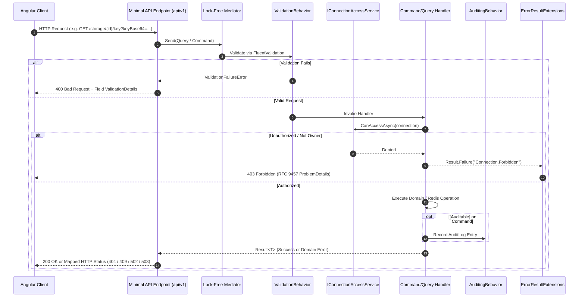
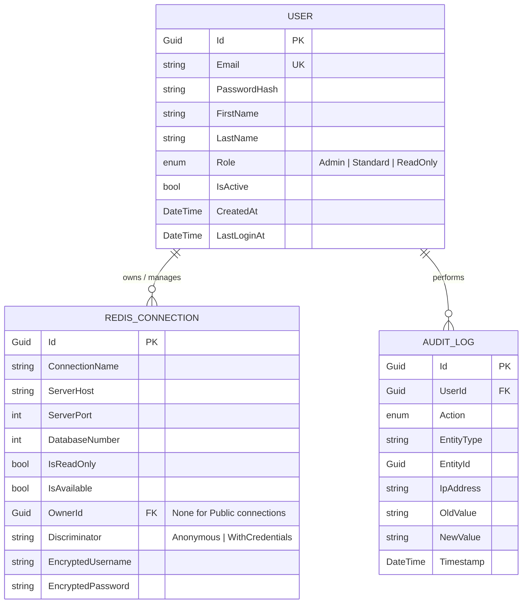
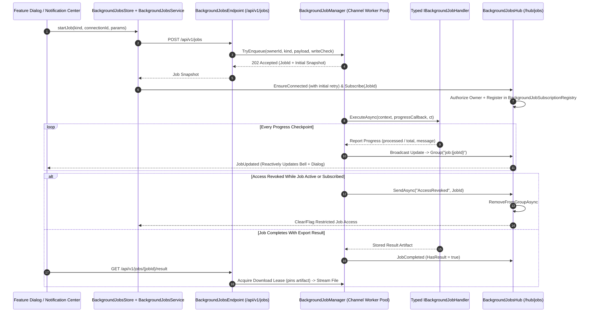
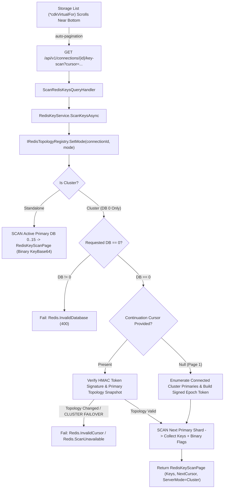
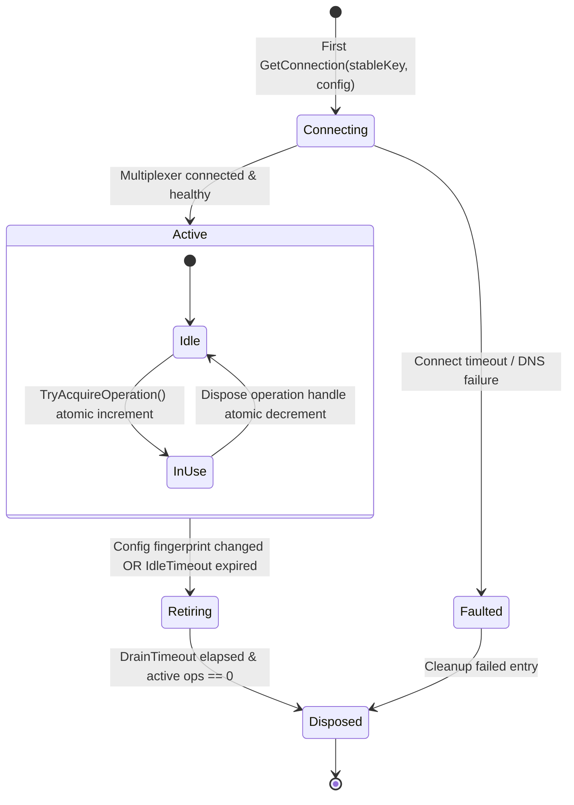
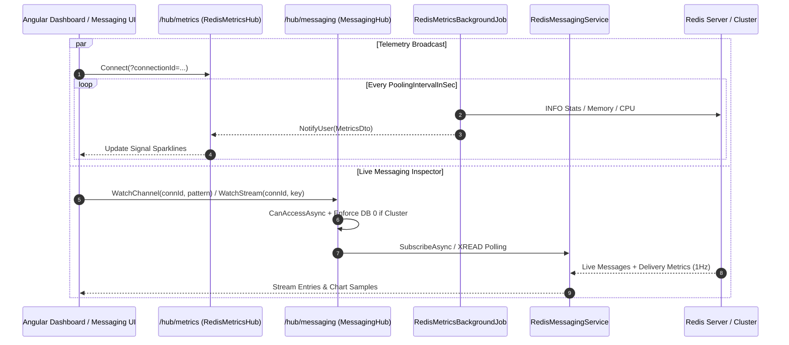

# RedisGUI — Architectural Diagrams & Operational Flowcharts

All system diagrams in **Mermaid** format illustrating the **.NET 11 + Angular 22** RedisGUI architecture, lock-free subsystems, Cluster topology handling, SignalR streaming hubs, and background job pipelines.

---

## 1. High-Level System Architecture

---

## 2. CQRS Request Lifecycle & RFC 9457 Problem Details

---

## 3. Domain & Persistence Entity Model

---

## 4. Extensible Background Jobs & Live SignalR Lifecycle

---

## 5. Redis Cluster Topology Detection & Failover-Safe Cursor `SCAN`

---

## 6. Lock-Free `RedisConnectionManager` State Machine

---

## 7. Real-Time Telemetry & Messaging Inspector Hubs

