# RedisGUI — Повний посібник користувача та інструкція по роботі

Цей посібник містить вичерпні покрокові інструкції щодо використання всіх функціональностей платформи **RedisGUI** із наочними скриншотами кожного екрана та діалогу.

---

## Зміст

1. [Автентифікація та вхід у систему](#1-автентифікація-та-вхід-у-систему)
2. [Головний дашборд та керування підключеннями](#2-головний-дашборд-та-керування-підключеннями)
   - [Огляд стану серверів та телеметрія](#огляд-стану-серверів-та-телеметрія)
   - [Діалог створення та редагування підключення](#діалог-створення-та-редагування-підключення)
3. [Менеджер сховища (Storage Manager)](#3-менеджер-сховища-storage-manager)
   - [Табличний режим (Table View) та Живі Метрики](#табличний-режим-table-view-та-живі-метрики)
   - [Дерево просторів імен (Namespace Tree View)](#дерево-просторів-імен-namespace-tree-view)
   - [Швидка палітра команд (Command Palette Ctrl+K)](#швидка-палітра-команд-command-palette-ctrlk)
   - [Створення нового ключа (Add Key Modal)](#створення-нового-ключа-add-key-modal)
4. [Візуальні редактори значень Redis](#4-візуальні-редактори-значень-redis)
   - [Редактор рядків та JSON (String / JSON Editor)](#редактор-рядків-та-json-string--json-editor)
   - [Редактор хешів (Hash Visual Editor)](#редактор-хешів-hash-visual-editor)
   - [Візуальний редактор стрімів (Stream Visual Editor)](#візуальний-редактор-стрімів-stream-visual-editor)
   - [JSON режим стрімів (Stream JSON Editor)](#json-режим-стрімів-stream-json-editor)
   - [Редактори списків, множин та сортованих множин](#редактори-списків-множин-та-сортованих-множин)
5. [Інтерактивна консоль Redis CLI](#5-інтерактивна-консоль-redis-cli)
6. [Навантажувальне тестування та бенчмарк (Load Testing)](#6-навантажувальне-тестування-та-бенчмарк-load-testing)
7. [Генератор реалістичних демо-даних (Sample Data Seeder)](#7-генератор-реалістичних-демо-даних-sample-data-seeder)
8. [Діагностика та аналізатор Slowlog](#8-діагностика-та-аналізатор-slowlog)
9. [Журнал аудиту та безпека (Audit Logs)](#9-журнал-аудиту-та-безпека-audit-logs)
10. [Теми оформлення та світлий режим (Themes & Light Mode)](#10-теми-оформлення-та-світлий-режим-themes--light-mode)

---

## 1. Автентифікація та вхід у систему

Для забезпечення безпеки доступу до ваших баз даних система використовує захищений шлюз автентифікації на основі криптографічних токенів JWT.

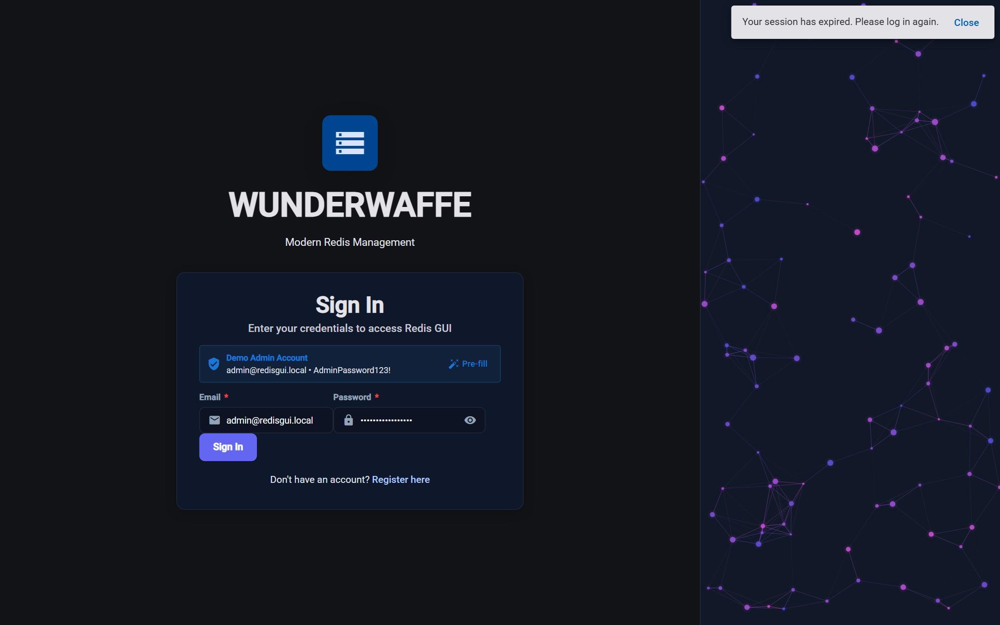

### Покрокова інструкція:
1. Перейдіть за адресою `http://localhost:5000` (або `http://localhost:4200` при локальній розробці).
2. За замовчуванням система автоматично ініціалізує обліковий запис адміністратора:
   * **Email**: `admin@redisgui.local`
   * **Пароль**: `AdminPassword123!`
3. Натисніть кнопку **Sign In**. Після успішної автентифікації токен автоматично збережеться, і вас буде перенаправлено на головний дашборд.

---

## 2. Головний дашборд та керування підключеннями

### Огляд стану серверів та телеметрія
Головний дашборд надає панорамний огляд стану всіх зареєстрованих екземплярів Redis, кластерів та автономних вузлів.

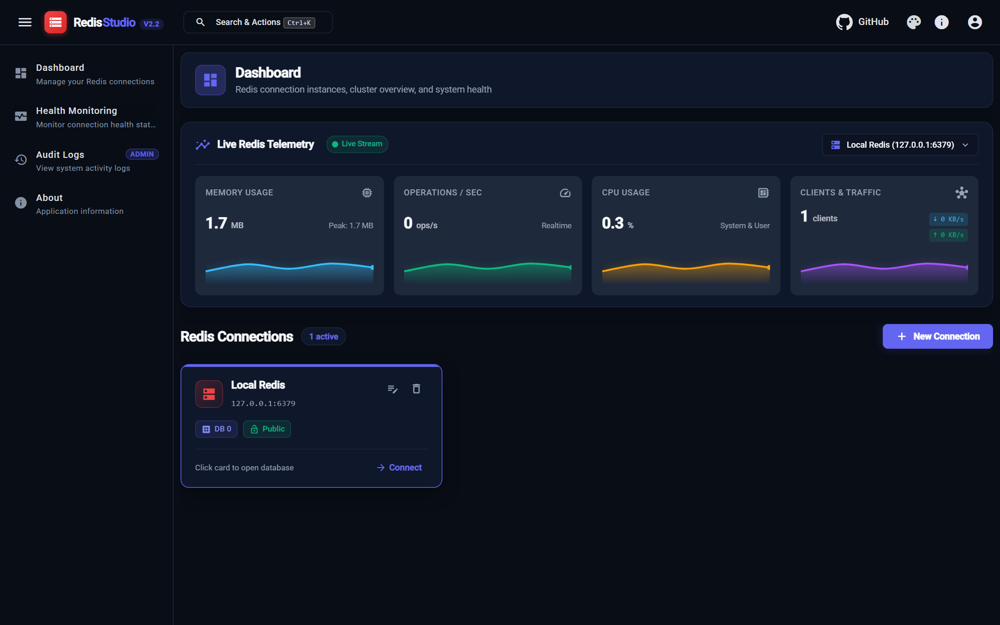

* **Карточки з'єднань**: Відображають ім'я з'єднання, хост, порт, кількість доступних баз даних та індикатор статусу підключення (Online / Offline).
* **Швидкі дії**: Кнопки швидкого переходу до менеджера сховища, редагування параметрів з'єднання, перевірки доступності та активації **Safe Mode** (захисту від запису).

### Діалог створення та редагування підключення
Для додавання нового екземпляра Redis натисніть кнопку **Add Connection** у верхньому правому куті дашборду.

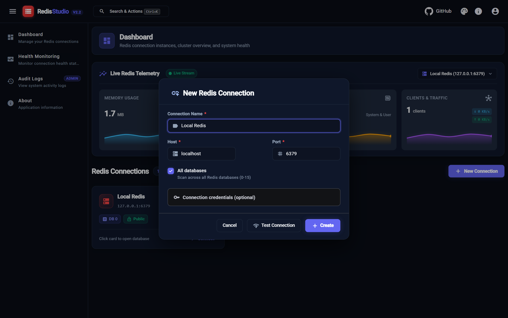

### Налаштування форми:
* **Connection Name**: Зручна назва (наприклад, `Production Cache`, `Staging Cluster`).
* **Host & Port**: IP-адреса або DNS-ім'я (наприклад, `127.0.0.1` або `redis.internal.net`) та порт (за замовчуванням `6379`).
* **Password**: Пароль доступу (AUTH) — шифрується перед збереженням у базі даних.
* **SSL / TLS**: Прапорець для активації захищеного з'єднання.
* **Safe Mode (Read-Only)**: Забороняє будь-які деструктивні операції, модифікації або видалення ключів на цьому з'єднанні.
* **Test Connection**: Кнопка попередньої перевірки зв'язку перед збереженням.

---

## 3. Менеджер сховища (Storage Manager)

Менеджер сховища — центральний робочий простір для керування даними у базах Redis.

### Табличний режим (Table View) та Живі Метрики

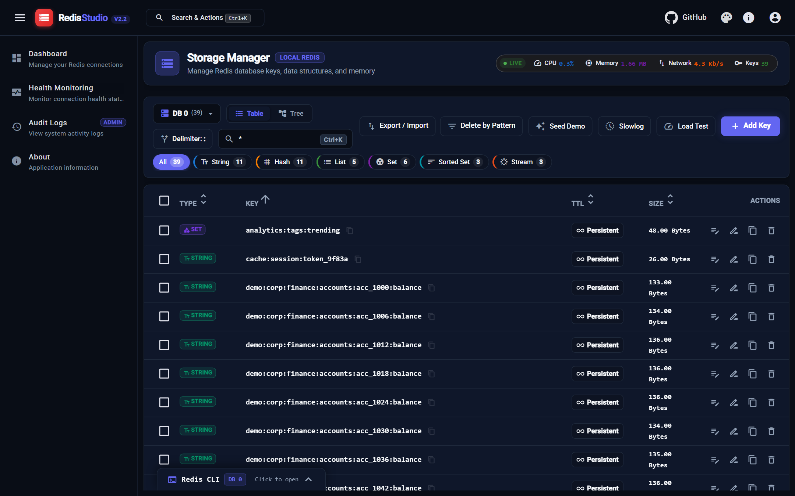

* **Панель живих метрик (Header Live Metrics)**:
  * **CPU**: Відсоток утилізації процесора сервером Redis.
  * **Memory**: Поточний обсяг пам'яті (RSS), що використовується процесом Redis, з автоматичним форматуванням байтів.
  * **Network**: Швидкість вхідного та вихідного мережевого трафіку (Kb/s).
  * **Keys**: Загальна кількість ключів в активній базі даних.
* **Вибір бази даних (Database Selector)**: Швидке перемикання між логічними базами від `DB 0` до `DB 15` із відображенням кількості ключів у кожній.
* **Фільтри за типами даних**: Інтерактивні чіпи у верхній частині таблиці (`All`, `String`, `Hash`, `List`, `Set`, `ZSet`, `Stream`) із лічильниками для миттєвої фільтрації.
* **Пошуковий рядок (Pattern Search)**: Пошук за регулярними виразами або масками (наприклад, `user:*`, `order:2026:*`).

### Дерево просторів імен (Namespace Tree View)
Перемикач режимів перегляду дозволяє трансформувати плаский список ключів у структуроване ієрархічне дерево:

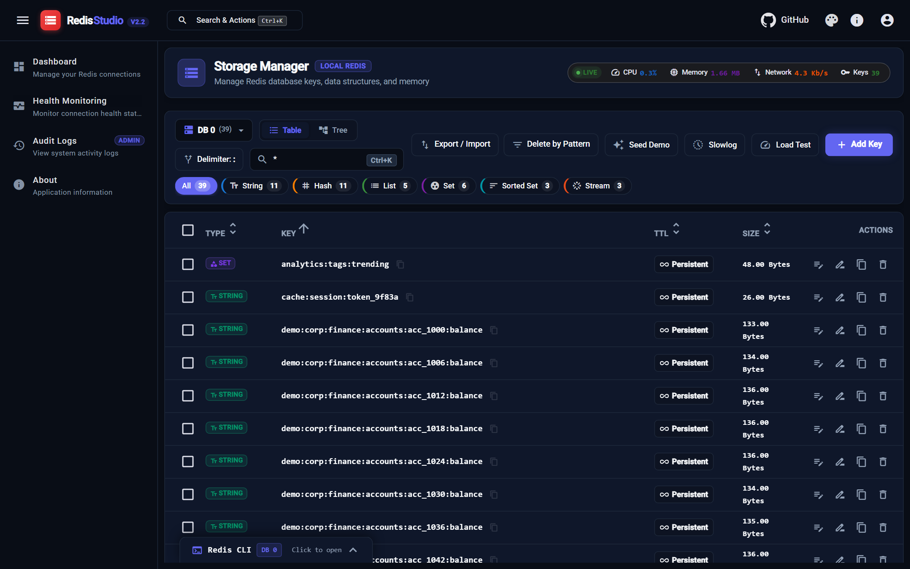

* Автоматично групує ключі за розділювачами (двокрапка `:`, слеш `/`, крапка `.`).
* Клік по папці розгортає або згортає групу.
* Клік по кінцевому вузлу відкриває відповідний ключ для перегляду та редагування.

### Швидка палітра команд (Command Palette Ctrl+K)
Натискання клавіш `Ctrl + K` або клік по кнопці з клавіатурним бейджем відкриває універсальну командну палітру для миттєвої навігації:

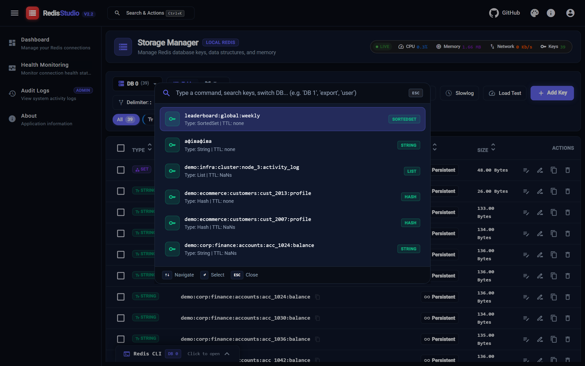

* Швидкий пошук та перехід до будь-якої дії (створення ключа, запуск тесту, зміна бази, відкриття терміналу).

### Створення нового ключа (Add Key Modal)
Для додавання ключа натисніть кнопку **Add Key**:

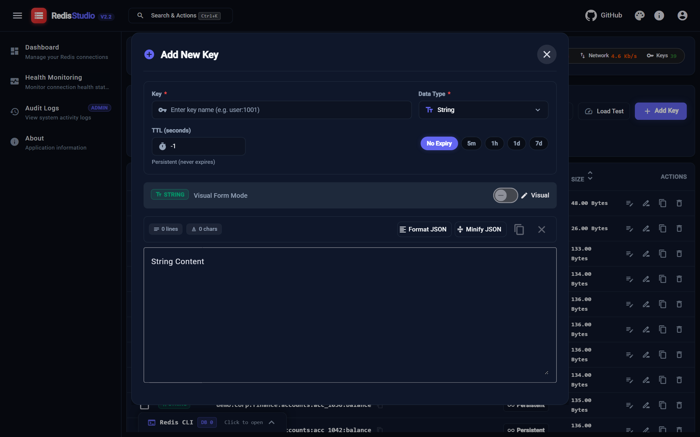

* **Key**: Унікальне ім'я ключа в активній базі.
* **Type**: Вибір строго типізованого типу даних (`String`, `Hash`, `List`, `Set`, `SortedSet`, `Stream`).
* **TTL (Time-to-Live)**: Час життя в секундах. Значення `-1` означає безстроковий (постійний) ключ.
* **Initial Value**: Початкове значення у зручному для типу форматі.

---

## 4. Візуальні редактори значень Redis

Для кожного з 6 підтримуваних типів даних у системі реалізовано окремі спеціалізовані панелі редагування з валідацією.

### Редактор рядків та JSON (String / JSON Editor)

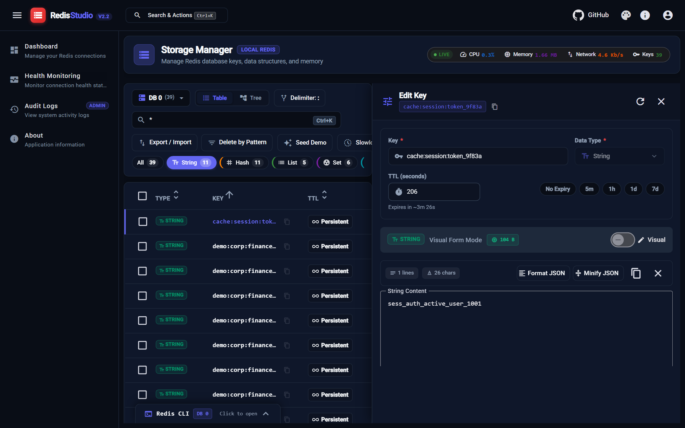

* Підтримує як простий текст, так і складні структуровані JSON-об'єкти.
* Автоматично підсвічує синтаксис, перевіряє валідність JSON та форматує документ із відступами.
* Дозволяє змінювати час життя (TTL) або видаляти ключ в один клік.

### Редактор хешів (Hash Visual Editor)

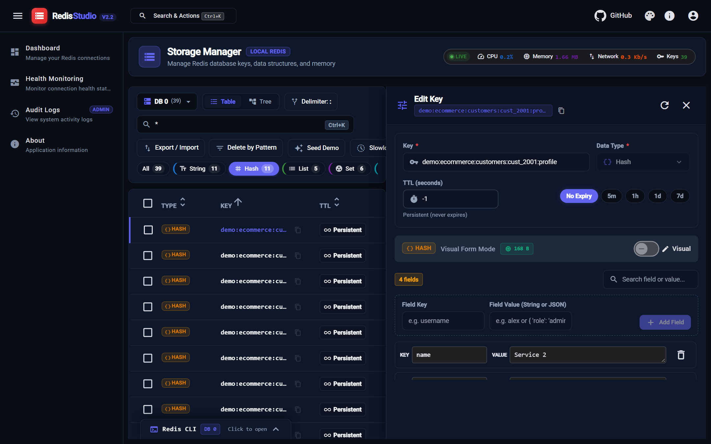

* Табличне представлення пар `Field` (поле) та `Value` (значення).
* Додавання нових полів безпосередньо у візуальній таблиці.
* Інлайн-редагування та миттєве видалення окремих полів хеша.

### Візуальний редактор стрімів (Stream Visual Editor)

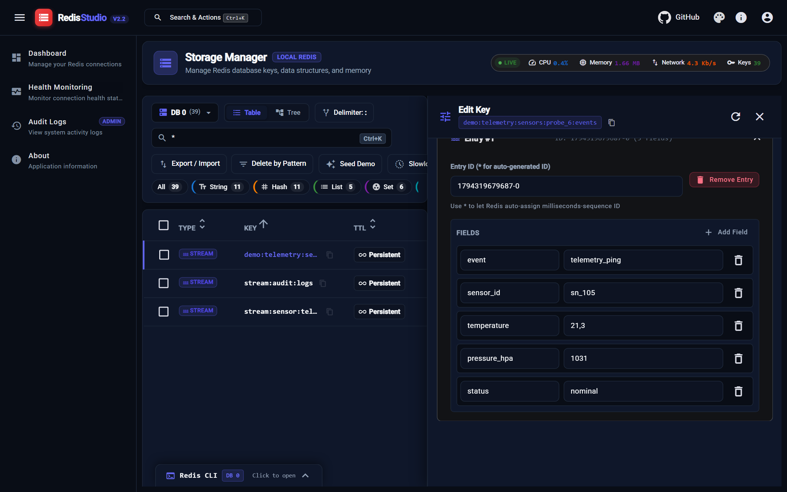

* Представляє записи стріма у вигляді часової шкали подій із точними мілісекундними ідентифікаторами (`timestamp-seq`).
* Кожен запис містить розгорнуті пари ключ-значення корисного навантаження телеметрії або логів.

### JSON режим стрімів (Stream JSON Editor)

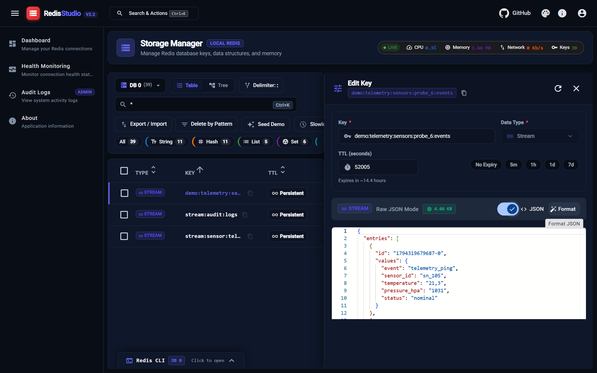

* Перемикач **Visual / JSON** дозволяє миттєво переглянути та скопіювати весь стрім у стандартизованому форматі JSON.

---

## 5. Інтерактивна консоль Redis CLI

Інтегрована консоль дозволяє виконувати низькорівневі команди Redis без необхідності встановлення `redis-cli` на хостову машину:

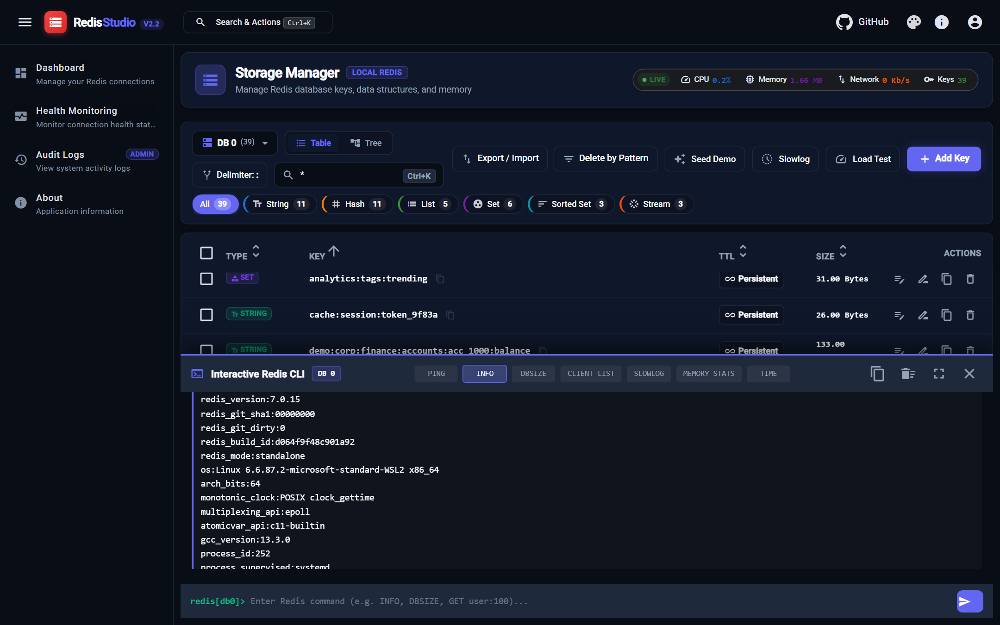

### Можливості консолі:
* **Висувний термінал (Drawer)**: Зручно відкривається поверх будь-якої сторінки кліком по нижній панелі.
* **Історія команд**: Навігація клавішами `↑` (вгору) та `↓` (вниз) по попередньо виконаних командах.
* **Контекст баз даних**: Команди виконуються саме в тій базі даних (`SELECT db`), яка активна на сторінці.
* **Форматований вивід**: Масиви RESP3 та відповіді команд (наприклад, `INFO`, `CLIENT LIST`, `MEMORY STATS`) рендеряться з чистою моноширинною типографікою.
* **Захист Safe Mode**: У разі активації безпечного режиму деструктивні команди блокуються ще до передачі на сервер.

---

## 6. Навантажувальне тестування та бенчмарк (Load Testing)

Вбудований модуль синтетичного тестування дозволяє виміряти реальну продуктивність і затримку сервера Redis:

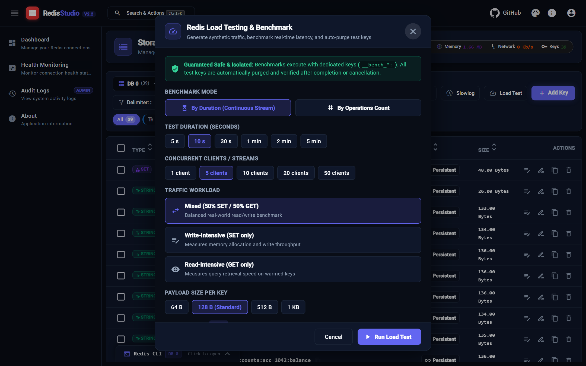

### Налаштування тесту:
* **Total Operations**: Кількість запитів (від 50 до 50,000).
* **Concurrency Workers**: Кількість паралельних асинхронних потоків (від 1 до 50 воркерів).
* **Workload Distribution**:
  * *Read Heavy*: 80% GET / 20% SET.
  * *Write Heavy*: 80% SET / 20% GET.
  * *Balanced*: 50% GET / 50% SET.
* **Звіт результатів**: Відображає сумарний час, кількість операцій за секунду (RPS), перцентилі затримки `p50`, `p95`, `p99` у мілісекундах та статус автоматичного прибирання тестових ключів.

---

## 7. Генератор реалістичних демо-даних (Sample Data Seeder)

Потужний інструмент для швидкого наповнення бази реалістичними наборами даних для розробки, навчання або стрес-тестів:

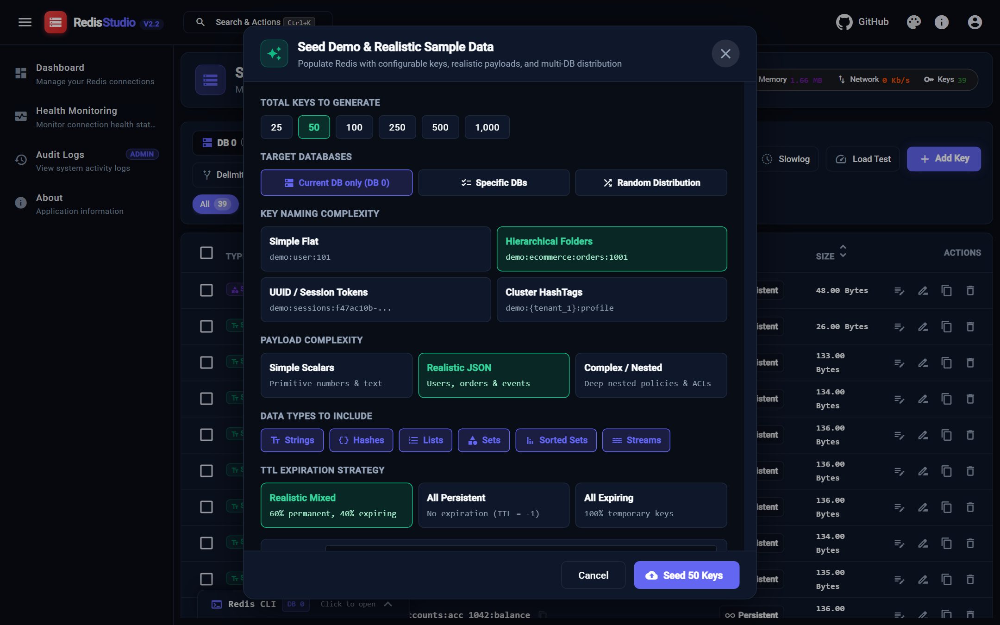

### Параметри генерації:
* **Key Count**: Кількість ключів для створення (до 10,000).
* **Key Complexity**:
  * *Simple*: `demo:string:1`
  * *Hierarchical*: `prod:europe:auth:session:1`
  * *UUID*: `orders:hash:3f4a-9b1c-...`
* **Data Types**: Вибір типів даних (можна згенерувати одночасно суміш рядків, хешів, списків, множин та стрімів).
* **TTL Strategy**: Постійні ключі, з випадковим часом життя або змішані.

---

## 8. Діагностика та аналізатор Slowlog

Діалогове вікно Slowlog дозволяє розробникам та адміністраторам виявляти повільні команди, що блокують головний потік Redis:

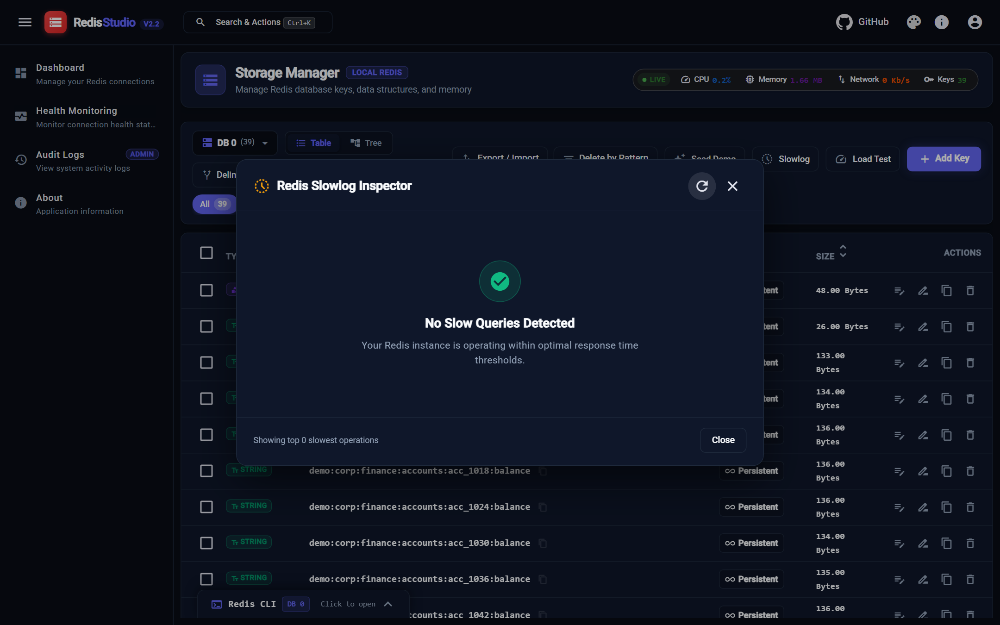

* Фіксує час запуску, IP-адресу клієнта, аргументи команди та точну тривалість виконання в мікросекундах (`µs`).
* Допомагає оптимізувати повільні неіндексовані операції `KEYS *`, сортування або важкі об'єднання множин.

---

## 9. Журнал аудиту та безпека (Audit Logs)

Кожна адміністративна дія, мутація ключа, запуск тесту або виконання команди в консолі незмінно записується в журнал безпеки:

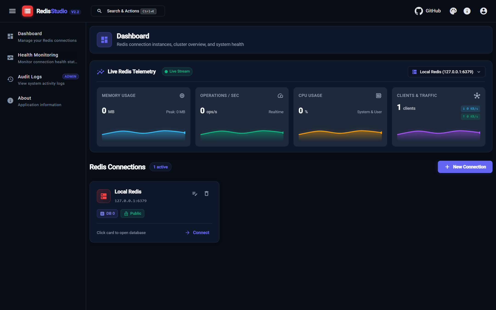

* **Фільтрація**: Пошук за email користувача, типом дії (`CreateKey`, `DeleteKey`, `ExecuteCli`, `LoadTest`), цільовим з'єднанням або датою.
* **Інспектор корисного навантаження**: Детальний перегляд параметрів запиту та результату у форматі JSON.

---

## 10. Теми оформлення та світлий режим (Themes & Light Mode)

RedisGUI містить гнучкий двіжок тем із підтримкою як глибокої темної теми, так і чистого світлого режиму:

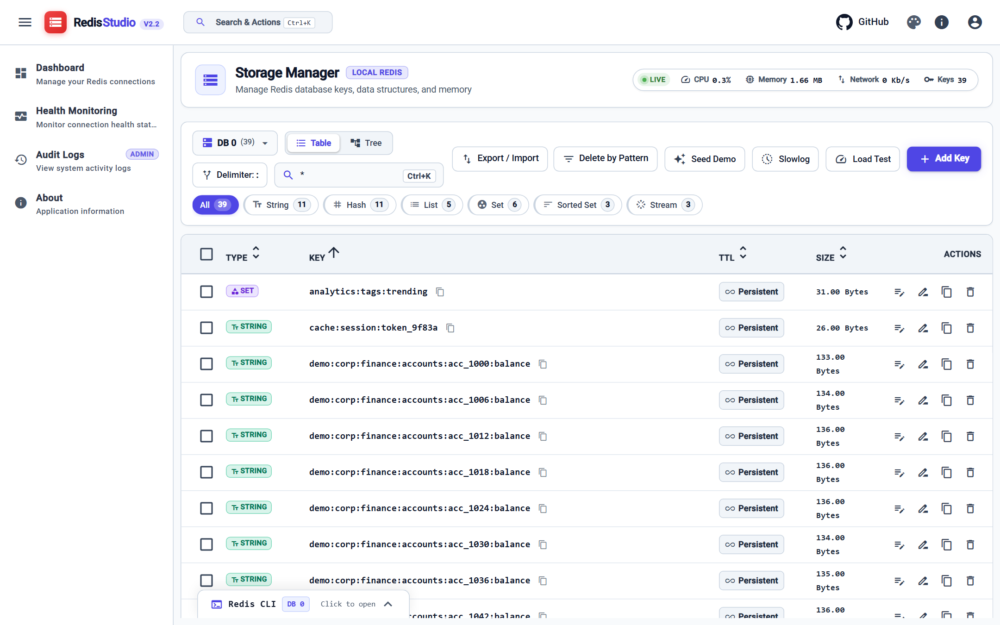

* **Доступні палітри**: Deep Violet (Magenta), Emerald Green, Indigo Night, Crimson Gold, Cyan Amber, Charcoal Dark.
* Швидке перемикання між світлим та темним режимами в один клік у шапці застосунку.
